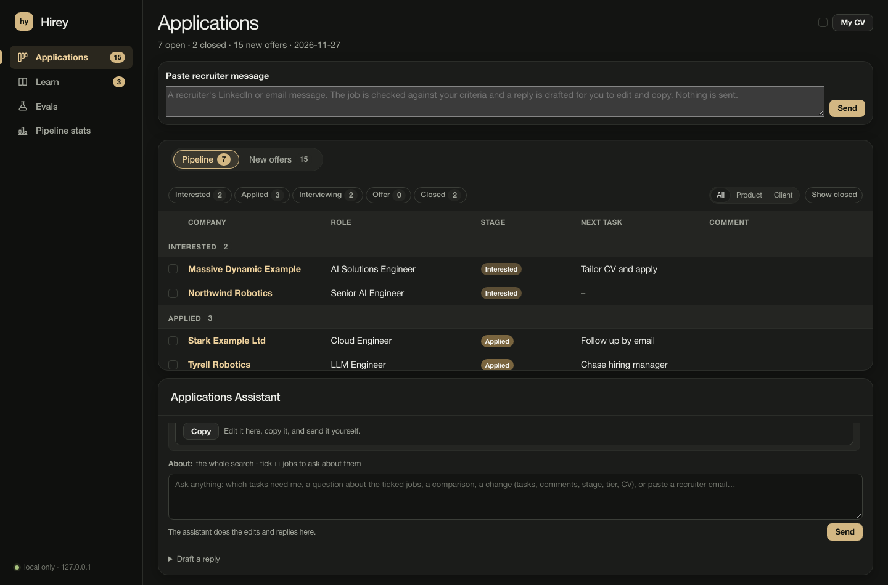
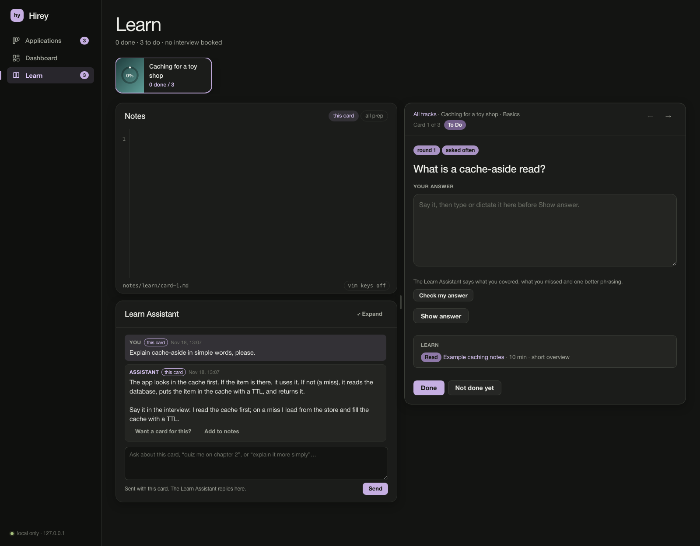
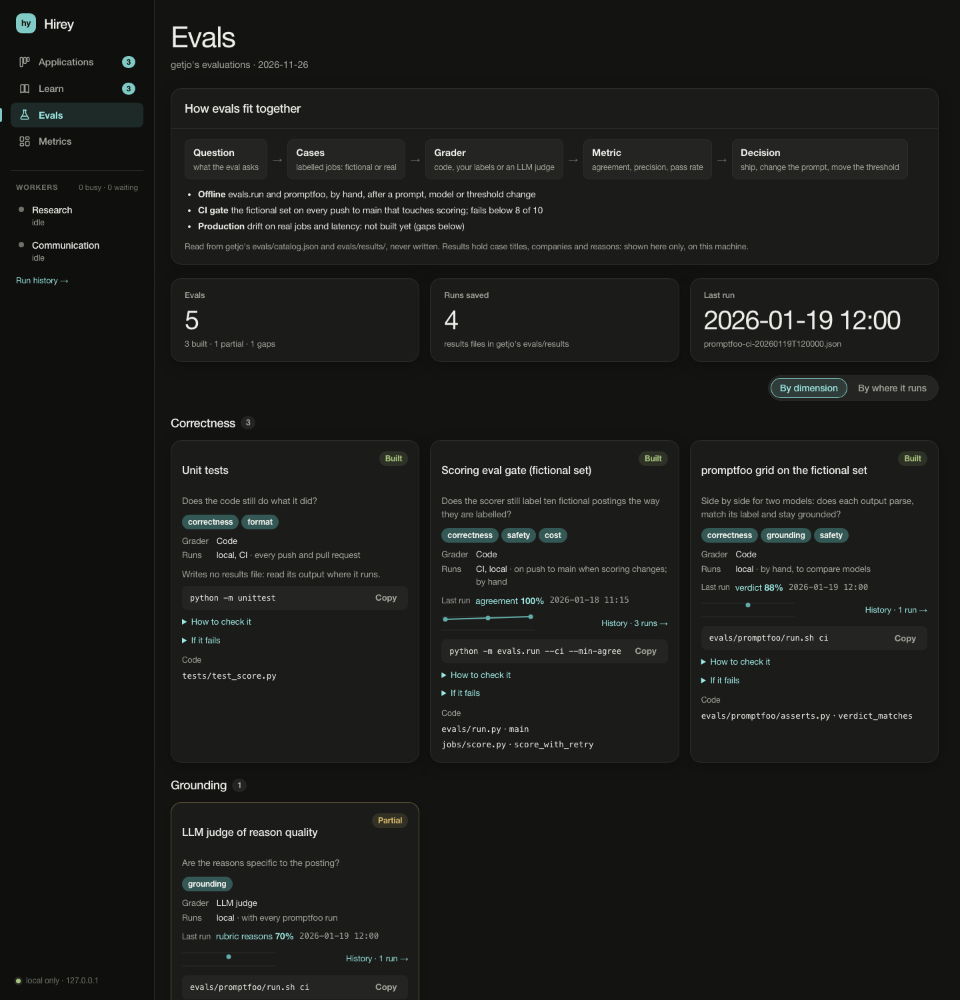
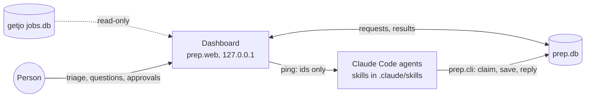

# Hirey

**A local workspace for a job search and interview prep, run together with Claude Code agents.**

Hirey keeps applications, tasks, CVs and interview practice in one local SQLite database. A
dashboard on `localhost` is where a person triages job offers, asks questions and approves the next
step. Claude Code agents do the work behind it through the skills in this repo: they research
companies, check and tailor the CV for each job, keep the pipeline current from pasted recruiter
emails, draft replies and explain interview topics. Job offers come from getjo, a separate job-radar
project that Hirey reads read-only. Nothing here applies to jobs, sends email or posts anywhere.

<!-- Screenshots: example data only (python -m prep.seed_example), never real applications. -->


| Learn: a card, its explainer and the Learn Assistant | Evals: getjo's evaluations in one place |
|---|---|
|  |  |

## What it does

- **Pipeline and new offers.** getjo's strong matches arrive as *New offers* with a short job brief;
  Interested or Skip. Stages move from pasted emails or a one-line message.
- **Assistants and workers.** An Applications Assistant answers in a chat box on the dashboard; a
  Research worker and a Communication worker take the long jobs in parallel. The Workers sidebar
  shows who is doing what, and Run history keeps every run.
- **Research and tailored CVs.** Company research, a CV fit score and a CV copy tailored to one job,
  each checked by rules and by a separate AI pass that traces every claim to the master CV.
- **Interview practice.** Debriefs of real interviews, gaps with drill tasks,
  and draft replies to recruiters (copied and sent by hand).
- **Learn.** Study cards by track, with notes, a Learn Assistant, and an explainer page per card
  that walks through the real code it is about.
- **Evals.** getjo's evaluations, their runs and history on one page.
- **Pipeline stats.** Applications per week, response rate and the stage funnel.

## How it fits together



The dashboard never calls a model: it stores a request and pings an agent with record ids. The
agent claims the work, writes private files and saves results through `prep.cli`. The full picture,
with one diagram per flow, is in [docs/how-it-works.md](docs/how-it-works.md).

## Quick start (example data)

Python 3.11+, standard library only (WeasyPrint, optional, renders the CV PDF).

```bash
python -m unittest                      # no network, no private files
python -m prep.seed_example             # made-up data in data/
PREP_ASSISTANT_TASK= PREP_PREP_ASSISTANT_TASK= PREP_WORKER_RESEARCH= PREP_WORKER_COMMS= \
PREP_DB=data/example.db PREP_GETJO_DB=$PWD/data/example-getjo.db \
  python -m prep.web --port 8766        # open http://localhost:8766
```

The empty `PREP_ASSISTANT_TASK=`, `PREP_PREP_ASSISTANT_TASK=` and `PREP_WORKER_*=` keep the example
from pinging real agents. The agent side runs in Claude Code from this directory (`/today`,
`/research`, `/ask`). Real setup: [docs/usage.md](docs/usage.md).

## Privacy and safety

- Personal data (CV, notes, research, databases, pay) lives in a gitignored private folder; a test
  and a pre-commit hook fail if any of it is tracked.
- The dashboard binds to loopback, escapes every value and never shows pay; pings carry ids only.
- Agents may rephrase, reorder or cut CV content, never invent it; pasted emails are data, not
  instructions. Details: [Boundaries and safety](docs/how-it-works.md#boundaries-and-safety).

## How it was built

A personal project. The author designed it, wrote the specifications and acceptance criteria
([docs/ROADMAP.md](docs/ROADMAP.md)) and reviewed every plan and pull request; the code was written
by Claude Code agents she directed, one per task in its own git worktree, coordinated on a kanban
board (dev3). [CLAUDE.md](CLAUDE.md) holds the rules they work under. Every change comes with unit
tests (no network, fixture data only), a privacy check and current docs; the agents' own output is
checked by the rule and AI checks above and by getjo's evals.

## Docs

- [docs/how-it-works.md](docs/how-it-works.md): system diagram, key flows, data model (start here)
- [docs/reference/](docs/reference/README.md): one page per area
- [docs/usage.md](docs/usage.md): setup, commands, standing agents, launchd
- [docs/ROADMAP.md](docs/ROADMAP.md): phases and acceptance criteria
