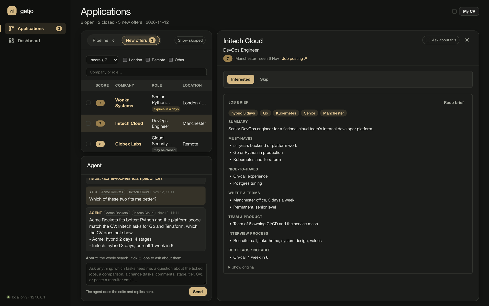
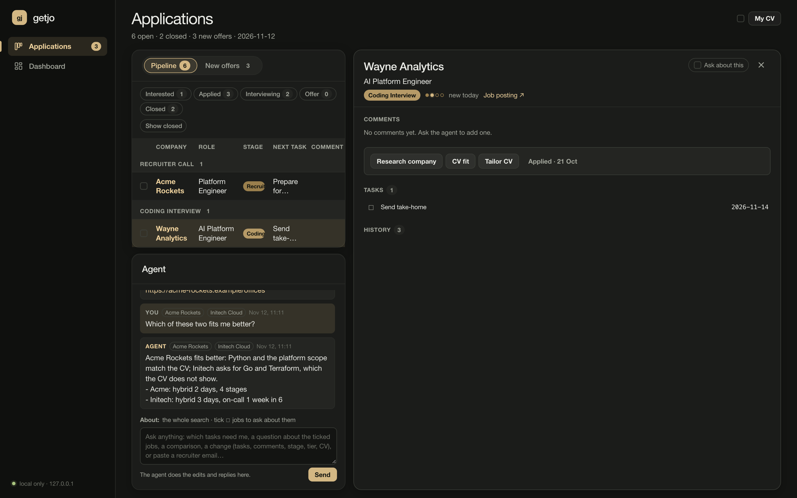
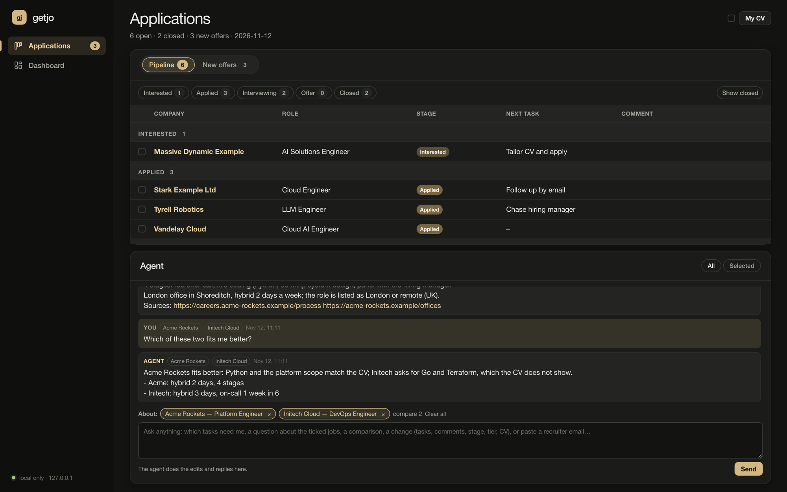
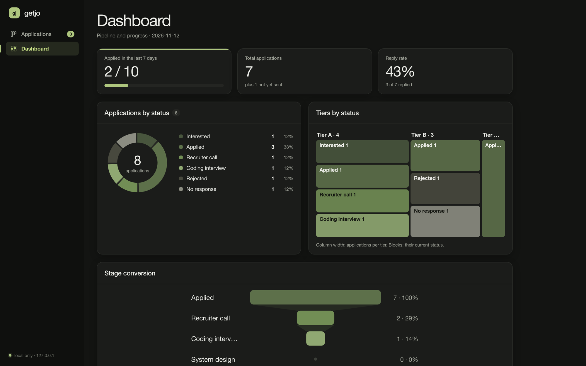
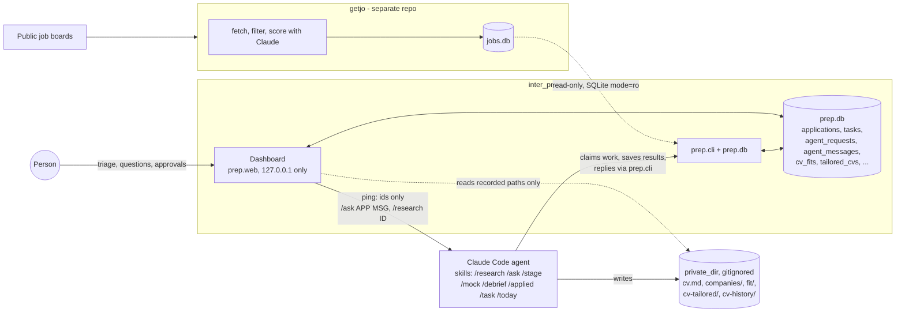

# inter_prep

**An agent-first workspace for running a job search with an AI assistant in the loop.**

inter_prep tracks job applications, tasks and interview preparation in one local SQLite
database. The work is shared between a local web dashboard and Claude Code agents. The
dashboard is where a person triages job offers, asks questions and approves the next step. The
agents research companies, check how a CV fits a job, write a tailored CV for each role, keep the
pipeline up to date from pasted recruiter emails and answer questions in a chat thread. The two
sides talk through a queue in the database. The dashboard never calls a model, and it pings the
agent with record ids only, never with text. Agents can rephrase, reorder or cut CV content but
never invent experience. Pasted emails are treated as data, not instructions. Job data comes
from a separate scoring service that this project only reads. Nothing here applies to jobs,
sends email or posts anywhere: the person decides and acts.

Python 3.11+, standard library by default (no frameworks, no build step; one pinned library,
WeasyPrint, renders the tailored CV PDF), 550 unit tests.

<!-- Screenshots: example data only (python -m prep.seed_example), never real applications. -->


| Pipeline and an application (Mock interview) | Comparing two ticked jobs | Dashboard |
|---|---|---|
|  |  |  |

## What it does

- **Triage job offers.** New jobs scored 7/10 or higher by getjo (the companion job-radar
  service) appear under *New offers* with filters and "may be closed" / "expires in N days"
  chips. Each is marked **Interested** or **Skip** with a reason. Every decision is stored as a
  labelled example (`feedback export` writes JSONL) to tune getjo's scoring prompt.
- **Job briefs.** The agent writes a short brief of each job description: a key-facts line
  ("hybrid 2 days · Python · Senior · London"), must-haves, nice-to-haves, terms, team,
  interview process and red flags. The original stays one click away. Offers scored 8 or more
  get a brief in the background, any other offer when its panel is first opened.
- **Agent homework on every Interested job.** Marking a job Interested queues *company
  research* (what the company does, size, stack, culture, interview process, news, with sources)
  and a *CV fit check* (score 1–5, gaps, suggested tier A/B/C). When both are saved, the person
  gets a "Review research and apply" task. Nothing is applied for automatically.
- **Tailored CV per job.** On request, the agent writes a new version of the master CV for one
  job: it rephrases, reorders and cuts, never invents, and lists questions where a figure or fact
  is missing. Every version is kept, and the one actually sent is recorded. Each version also
  gets an ATS-friendly PDF and a **rule check** that gives a verdict (Ready / Look at these
  lines / Blocked). The check flags changed dates, another company's name, missing must-have
  keywords, pay, and signs of machine-written text (stock phrases, repeated openers, bullets
  with no numbers). It also lists what changed against the master CV. Every save also queues an
  **AI check** run in a separate pass from the one that wrote the CV: each changed or added claim
  is traced to the master CV or a private facts bank (an unsourced claim blocks), the CV fit is
  scored again on the tailored copy and compared with the master CV's, and the top of page one
  gets a six-second skim score. Its findings join the same verdict.
- **One conversation with the agent.** The Agent box on the Applications page is a chat thread.
  Ticking rows sets what a message is about: one job (tracked or not), the master CV, nothing
  (the whole search), or two to four jobs for a side-by-side **comparison** of differences, pros
  and cons and fit per role. Examples: "which tasks
  need me?" (top 3 in a fixed review order), "is this role remote?", "move the interview to
  Friday", "add Terraform to my skills". The agent answers, runs the CLI command for a change, and
  the page refreshes on its own.
- **Pipeline from free text.** A pasted recruiter email or call notes move the application to the
  right stage (Interested → Applied → Recruiter call → Coding interview → System design → Company
  interview → Offer, or a closed outcome), with the interview date, a short comment and new
  to-dos. Each stage adds its own prep tasks and closes the previous stage's tasks. An application
  with no reply for 14 days moves to *No response* on its own.
- **Interview practice.** A mock interview runs in the Agent box for a chosen stage: one
  question per reply, then 1–5 scores per area. `/debrief` turns a pasted transcript of a real
  interview into questions, what went well and what to improve. Each weakness becomes a gap with
  a drill task, and the Dashboard shows score trends per area.
- **Master CV with history.** CV changes go through the agent only: a backup of the current text
  first, then an atomic replace. The panel shows skills by theme, versions, diffs and restore with
  undo.
- **Dashboard.** Weekly target, reply rate, and server-rendered SVG charts: status donut, tier ×
  status treemap, stage-conversion funnel, applications per week, practice scores.
- **Daily brief.** `/today` lists what moved, what is due, pending agent work and new strong
  matches.

## Architecture



How a request moves through the system, using "Tailor CV" as the example:

1. The person clicks **Tailor CV** in an application's panel. The dashboard inserts a pending
   row in `agent_requests` and, if a standing assistant is set up, sends it
   `dev3 message "/research <id>"`. The argv is built from ids only, with no shell and a
   timeout. Without an assistant, the request waits for the next Claude Code session (a
   SessionStart hook prints the pending ids).
2. The agent runs the `/research` skill. `prep.cli research next` claims the request atomically
   (pending → claimed; stale claims expire) and prints a work packet. The agent reads the CV and
   the job description, writes `cv-tailored/CV_<Company>_<Role>_<DDMMYY>_<n>.md`, and runs
   `prep.cli tailor save`, which records the version and posts the agent's note and questions in
   the thread.
3. The dashboard polls the thread, shows "Tailored CV ready · v2" and renders the file read-only.
   It opens only a path that is recorded in the database and resolves inside `private_dir`.
4. The person replies in the Agent box ("lead with the platform work"). That message is a new
   queued item, and the loop repeats.

The components and the full data flow are in [docs/how-it-works.md](docs/how-it-works.md).

## Safety boundaries

The dashboard-side boundaries are enforced in code and covered by tests. The agent-side ones
(prompt injection, no invented experience) are rules in the skills, and the review loop backs them up.


| Boundary | How |
|---|---|
| The model never acts in the world | No code path applies to jobs, sends email or posts. Agents edit only local files and the local database through `prep.cli`. |
| Ids-only pings | The dashboard sends the agent a fixed command with record ids. Message text, CV text and pay never leave the database through the ping. |
| Prompt injection from pasted text | The skills treat emails and job descriptions as data, never as instructions. A pasted email maps to a narrow set of commands: stage, comment, task. Its text stays out of comments. |
| No invented experience | Tailoring and CV edits may rephrase, reorder and cut, never add. Missing facts become questions in the thread. A rule check blocks changed dates and flags another company's name in each tailored CV, and a separate AI pass blocks any claim it cannot trace to the master CV or the facts bank. |
| Read-only upstream | getjo's database is opened with SQLite `mode=ro`. A write attempt fails, and a test checks that. inter_prep never imports getjo code. |
| Local only | The dashboard binds to loopback and refuses other addresses. It checks the Host header (DNS rebinding) and rejects cross-origin POSTs. CSP is `'self'`, there are no external requests, and every database value is escaped. |
| Personal data stays out of git | CV, notes, research, tailored CVs and databases are gitignored. `prep/privacy.py` fails a test and a pre-commit hook if any of them is tracked. Pay is never rendered or logged, and the skills keep it out of agent files. |
| Safe CV writes | The current CV is backed up first, then replaced atomically (temp file + `os.replace`). Empty or unchanged text is refused. Restore can be undone. |

## Try it with example data

Example databases are built from made-up fixtures (fictional companies only).

```bash
git clone <this repo> inter_prep && cd inter_prep
python -m unittest                      # 530 tests, no network, no private files needed
python -m prep.seed_example             # data/example.db + data/example-getjo.db
PREP_ASSISTANT_TASK= PREP_DB=data/example.db PREP_GETJO_DB=$PWD/data/example-getjo.db \
  python -m prep.web --port 8766        # then open http://localhost:8766
PREP_ASSISTANT_TASK= PREP_DB=data/example.db PREP_GETJO_DB=$PWD/data/example-getjo.db \
  python -m prep.cli today
```

The empty `PREP_ASSISTANT_TASK=` keeps the example run from messaging a real assistant. The PDF
step needs WeasyPrint in a virtual environment (`.venv`, from `requirements.txt`); without it, the
two PDF render tests are skipped and everything else works. The
agent features run in Claude Code from this directory: open a session and type `/today`,
`/research` or `/ask`. The real setup (settings file, getjo path, launchd, standing assistant)
is in [docs/usage.md](docs/usage.md). It covers the venv and the launchd job, which runs
`.venv/bin/python`.

## Repository map

```
prep/            db.py (schema, migrations, queue, stage rules) · cli.py (every command the agents use)
                 web.py (dashboard) · stats.py + charts.py (numbers, SVG) · getjo.py (read-only view)
                 research.py · cvfile.py · cvcheck.py (tailored CV rules) · cveval.py (AI check) · cvpdf.py (PDF)
                 assistant.py (ids-only ping) · privacy.py · static/
.claude/skills/  today, applied, stage, task, research, ask, mock, debrief: the agent's instructions, each
                 backed by python -m prep.cli
.claude/settings.json   SessionStart hook: read-only queue summary (ids only)
tests/           unittest suite with fixture databases
docs/            how-it-works.md · usage.md · ROADMAP.md
```

## How it was built

The author designed and directed this project, and AI coding agents implemented it. The
author wrote the specifications and acceptance criteria (see [docs/ROADMAP.md](docs/ROADMAP.md)),
broke the work into tasks, reviewed each agent's plan before implementation, and reviewed every
pull request and the running dashboard.

- **Implementation:** Claude Code agents, one per task, each in its own git worktree, orchestrated
  on a kanban board (dev3). A coordinator agent split phases into tasks, and each task agent
  proposed a plan, implemented, tested and opened a PR.
- **Rules for agents:** [CLAUDE.md](CLAUDE.md) sets the constraints every agent works under
  (standard library by default, privacy rules, schema-migration rules, test and documentation duties).
  The same agents then *use* the project at run time through the skills in `.claude/skills/`.
- **Quality bar:** tests for every change (530 now, no network, fixture data only), a privacy
  check on every commit, and `docs/how-it-works.md` kept current with each change.

## Docs

- [docs/usage.md](docs/usage.md): setup, commands, dashboard reference, standing assistant,
  launchd, privacy model
- [docs/how-it-works.md](docs/how-it-works.md): components and data flow
- [docs/ROADMAP.md](docs/ROADMAP.md): phases and acceptance criteria
- [CLAUDE.md](CLAUDE.md): conventions for the coding agents working in this repo
