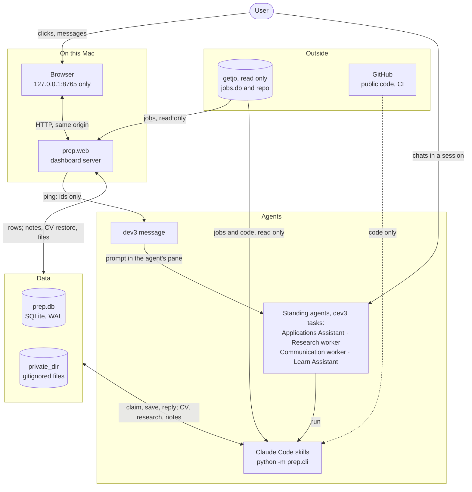
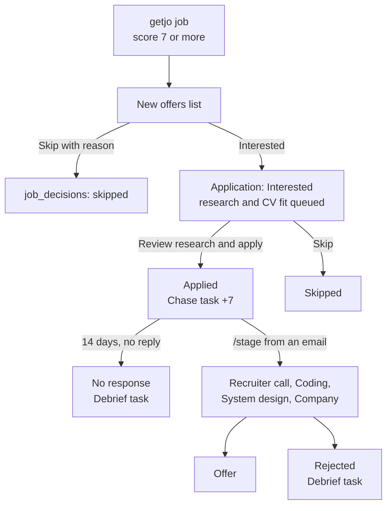
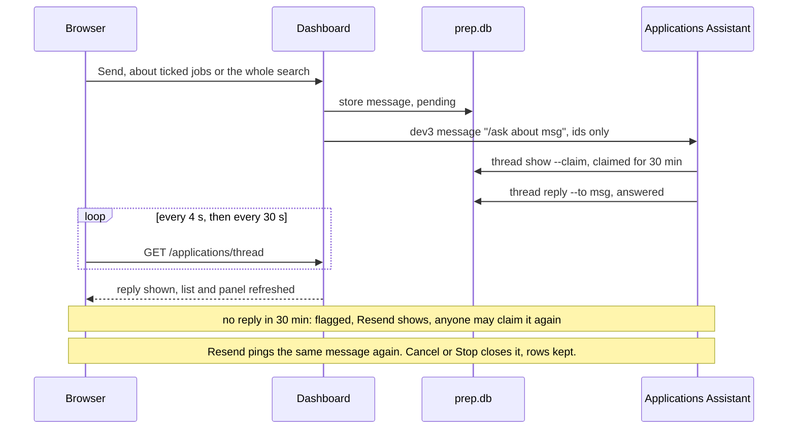
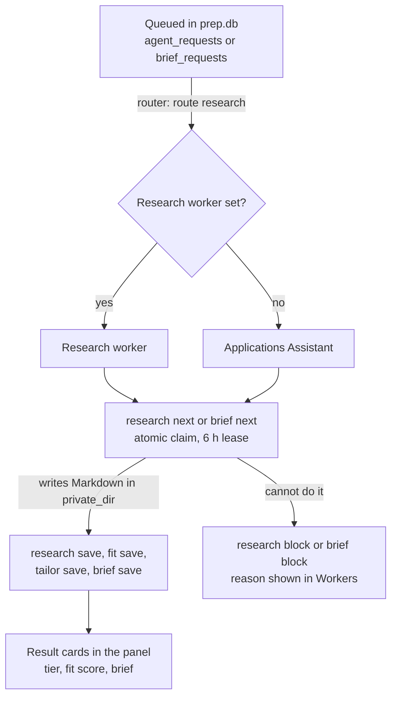
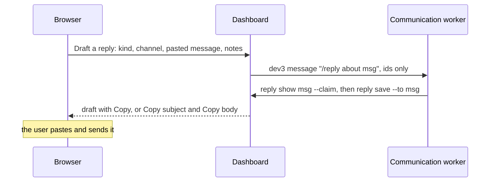
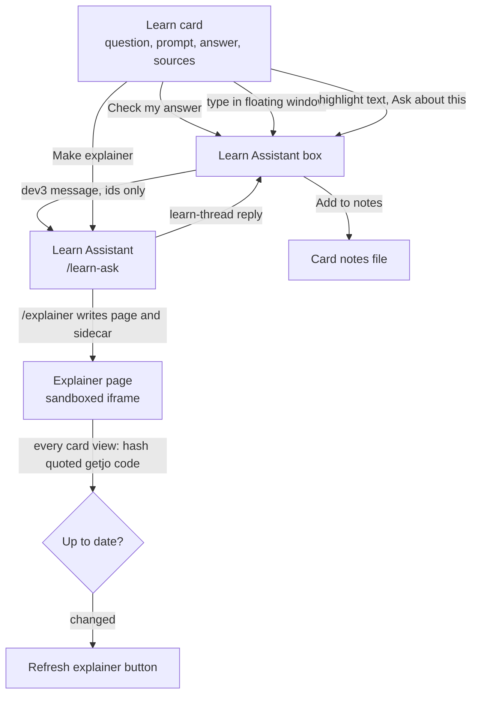
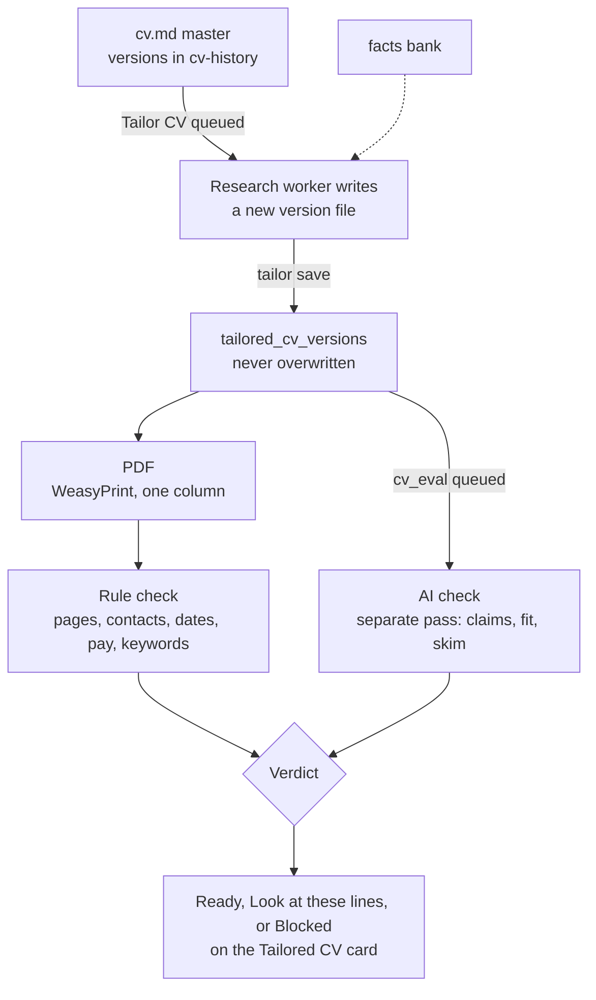
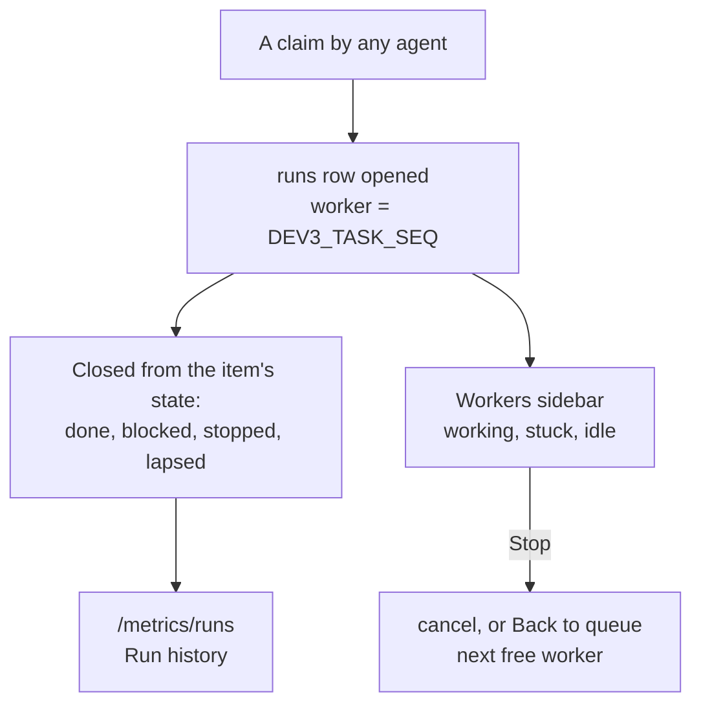
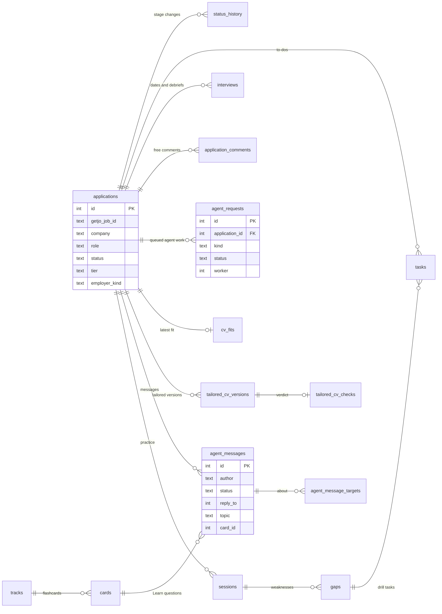

# How Hirey works

Hirey is a local workspace for a job search. It tracks applications, tasks and interview preparation
in one SQLite database, `prep.db`. Two front ends share it: a dashboard in the browser (loopback only)
and Claude Code skills run by standing agents in dev3. Job matches come read-only from **getjo**, a
separate project that scores public job posts.

> **Start here**
>
> 1. Look at the [system diagram](#the-system-at-a-glance): who talks to what.
> 2. Pick the [key flow](#key-flows) for the area of interest. Each one is a diagram and a few lines.
> 3. Follow its links into the [reference pages](reference/README.md) for every rule, command and
>    endpoint.
>
> Setup and day-to-day commands are in [usage.md](usage.md). Planned work is in
> [ROADMAP.md](ROADMAP.md).

## Contents

- [The system at a glance](#the-system-at-a-glance)
- [Components](#components)
- [Key flows](#key-flows)
  - [A. From getjo match to application](#a-from-getjo-match-to-application)
  - [B. A message in the Applications Assistant box](#b-a-message-in-the-applications-assistant-box)
  - [C. Research, CV fit and job briefs](#c-research-cv-fit-and-job-briefs)
  - [D. Drafting a reply to a recruiter](#d-drafting-a-reply-to-a-recruiter)
  - [E. Learn](#e-learn)
  - [F. Master CV to tailored CV](#f-master-cv-to-tailored-cv)
  - [G. Workers sidebar and run history](#g-workers-sidebar-and-run-history)
- Evals (planned: its own dashboard page, `/evals`; docs to come)
- [Data model](#data-model)
- [Configuration](#configuration)
- [Boundaries and safety](#boundaries-and-safety)
- [Reference pages](#reference-pages)
- [Writing the docs](#writing-the-docs)

## The system at a glance

- The **dashboard never runs an agent**. It stores a request or message in prep.db and, when an agent
  is configured, sends it a short `dev3 message` holding ids only.
- The **agents never touch the browser**. They read their work from prep.db through `prep.cli`,
  write files under `private_dir`, and save results back through `prep.cli`.
- **getjo** is only read: its `jobs.db` with SQLite `mode=ro`, and its git checkout for explainer
  checks. Hirey never writes to it and never imports its code.
- **GitHub** holds the public code. Private data (CV, notes, sessions, databases, pay) never goes into
  a committed file; `prep/privacy.py` and the pre-commit hook check that.

## Components

| Component | What it does | Where |
| --- | --- | --- |
| Dashboard server | pages, forms, JSON polling; loopback only | `prep/web.py`, `prep/static/` |
| Commands | everything skills do: claim, save, reply, update | `prep/cli.py` |
| Database layer | schema, migrations, every query and rule | `prep/db.py` |
| getjo reader | matches, job state, descriptions, read only | `prep/getjo.py` |
| Router and ping | which agent gets each kind of work; `dev3 message` | `prep/assistant.py` |
| Workers view | each agent's state, queue and runs | `prep/workers.py` |
| Research files | front matter of research, fit and tailored CV files | `prep/research.py` |
| Master CV | versions, skills, diff, draft and save | `prep/cvfile.py` |
| CV PDF | tailored CV to PDF (WeasyPrint) | `prep/cvpdf.py`, `prep/cv_template.html` |
| CV checks | rule check; AI check results | `prep/cvcheck.py`, `prep/cveval.py` |
| Learn | tracks, chapters, cards; notes files; explainers | `prep/learn.py`, `prep/learnnotes.py`, `prep/explainers.py` |
| Metrics | application numbers; token usage and prices | `prep/stats.py`, `prep/usage.py`, `prep/prices.py`, `prep/charts.py` |
| Markdown | safe, escaped Markdown subset | `prep/md.py` |
| Settings | TOML settings and env overrides | `prep/config.py` |
| Privacy check | no private file is tracked | `prep/privacy.py`, `scripts/pre-commit` |
| Skills | /today, /applied, /stage, /task, /research, /ask, /reply, /mock, /debrief, /learn-ask, /explainer | `.claude/skills/` |
| SessionStart hook | read-only queue line at the start of a session | `.claude/settings.json` |
| launchd job | keeps the dashboard running | `launchd/` |

## Key flows

### A. From getjo match to application

- A match is an open getjo job above the score that is neither tracked nor decided.
- Every triage choice is stored in `job_decisions` with a copy of the job, so the labels survive getjo
  dropping it and can be exported to tune getjo's scoring.
- Every stage change goes through one function, `db.move_application`. It writes history, records
  interview dates and closes and adds the stage's automatic tasks, so the to-do list follows the
  pipeline.
- `/stage` turns a pasted recruiter email into that move plus a short comment.

Reference: [applications.md](reference/applications.md),
[dashboard.md](reference/dashboard.md#applications-page-pipeline-view).

### B. A message in the Applications Assistant box

- The ticks say what the message is about: nothing (the whole search), one application, one job offer,
  the master CV, or 2 to 4 targets (a comparison).
- The ping is a fixed argument list built from ids, never text. If dev3 cannot be reached, the
  message simply waits in prep.db for the next session.
- A claim is atomic, so two agents never answer one message. A claim with no reply after 30 minutes
  lapses, and any session may take the message again.

Reference: [assistants.md](reference/assistants.md#applications-assistant-box).

### C. Research, CV fit and job briefs

- Work is queued by Interested, by the panel's buttons (Research company, CV fit, Tailor CV, Write
  brief) and by every tailored CV save (its AI check). One open request per application and kind.
- The router is plain code: research-route work goes to the Research worker when one is set, else to
  the Applications Assistant.
- The worker writes the result as a Markdown file with front matter; the save command reads it into
  prep.db, closes the request and updates the panel on its next poll.

Reference: [research.md](reference/research.md), [assistants.md](reference/assistants.md#routing).

### D. Drafting a reply to a recruiter

- Kinds: reply, follow-up, thank-you note; channels: LinkedIn (no subject) or email (subject needed).
- The pasted message is data to answer, never instructions. Pay appears in a draft only when the user's
  notes give it.
- Nothing is sent: Hirey has no mail or LinkedIn integration. A clear interview booking in the pasted
  message is recorded as a stage; anything else is only proposed.

Reference: [assistants.md](reference/assistants.md#draft-a-reply-communication-worker).

### E. Learn

- Cards sit in tracks and chapters; progress is cards done out of all, with no schedule.
- The Learn Assistant is a second standing agent with its own conversation; Applications readers never
  see Learn messages.
- An explainer records the getjo commit and a hash of each function it quotes. Each card view hashes
  that code again, so a page explaining code that has since changed is flagged.

Reference: [learn.md](reference/learn.md).

### F. Master CV to tailored CV

- The master CV changes only through `cv save` from a draft, with a backup version first. Tailoring
  rephrases, reorders and cuts; it never invents experience.
- Every save of a tailored version makes its PDF, runs the rule check and queues the AI check. One
  verdict merges both: Blocked when any finding blocks.
- Which version was sent is recorded only when the user says so (`cv sent`).

Reference: [cv.md](reference/cv.md).

### G. Workers sidebar and run history

- Every page's sidebar lists each configured agent with its state, current item, queue and last runs.
- It shows kinds, company or job names, card ids, times and blocked reasons only: never message text or
  pay.
- Stop ends that worker's open runs in prep.db; the agent's terminal is not touched.

Reference: [assistants.md](reference/assistants.md#workers-sidebar-and-run-history).

## Data model

The main tables and how they link. Every table and column is in
[database.md](reference/database.md).

Not shown: `job_decisions` and `job_briefs` / `brief_requests` (keyed by getjo job id),
`company_profiles` (keyed by company slug), `cv_versions`, `runs` and the `usage_*` tables.

## Configuration

Settings are one TOML file: `$INTERPREP_SETTINGS`, else `config/settings.toml` in the checkout, else
`~/.config/inter_prep/settings.toml` (the normal place). `PREP_*` env vars override single keys.

| Setting | Purpose | Default |
| --- | --- | --- |
| `getjo_db`, `prep_db`, `private_dir` | where the data lives (absolute paths) | `prep_db`: `data/prep.db` |
| `assistant_task`, `prep_assistant_task` | Applications and Learn Assistant task seqs | unset: no ping |
| `[workers] research`, `comms` | Research and Communication worker seqs | unset: Applications Assistant |
| `dashboard_port` | dashboard port | 8765 |
| `no_response_days` | days in Applied before No response | 14 |
| `brief_auto_min_score` | score that gets a job brief queued automatically | 8 |

Every key, env var and the launchd job: [configuration.md](reference/configuration.md).

## Boundaries and safety

- **getjo is read-only.** Its database is opened with `mode=ro`; its code is never imported. The `jobs`
  table shape is the only contract.
- **Nothing is sent or applied.** Hirey never applies to a job, sends email or contacts anyone. Drafts
  are copied and sent by the user.
- **Loopback only.** The dashboard binds to 127.0.0.1, checks the Host header and refuses cross-origin
  posts. It makes no outgoing requests besides the optional local `dev3 message`.
- **The ping carries ids only**, never message text, form text or pay.
- **Pay stays in prep.db**: `applications.pay` (never rendered) and messages as the user pasted them.
  It never goes into committed files, logs, pings or anything an agent writes, unless the user asks.
- **Private files stay private.** CV, notes, sessions, research, fit files and tailored CVs live in
  `private_dir` and gitignored paths; `prep/privacy.py` checks none is tracked.
- **Logs hold ids, kinds and request lines only**, never CV text, notes, research or message bodies.

## Reference pages

| Page | Covers |
| --- | --- |
| [applications.md](reference/applications.md) | matches, triage, stages, stage tasks, comments, notes, review order, `/today` |
| [assistants.md](reference/assistants.md) | standing agents, routing, pings, claims and leases, the box, Resend / Cancel / Stop, drafts, Workers |
| [research.md](reference/research.md) | research queue, company profiles, CV fit, tier, job briefs |
| [cv.md](reference/cv.md) | master CV, tailored CV versions, PDF, rule check, AI check |
| [practice.md](reference/practice.md) | sessions, gaps and drills, debriefs, mock interviews |
| [learn.md](reference/learn.md) | cards, import, notes, the Learn page, Learn Assistant, explainers |
| [dashboard.md](reference/dashboard.md) | server, hardening, app.js, each page and panel |
| [routes.md](reference/routes.md) | every endpoint, one line each |
| [database.md](reference/database.md) | every table, allowed values, migrations |
| [metrics.md](reference/metrics.md) | stats definitions, token usage, prices |
| [configuration.md](reference/configuration.md) | settings, env vars, launchd |

## Writing the docs

- This page is the map; each [reference page](reference/README.md) owns one area. When a component or
  flow changes, update its diagram here and the one reference page that owns it.
- Diagrams are Mermaid (GitHub renders it): one diagram per flow, labelled arrows, conservative syntax
  (quoted labels).
- No table cell longer than about 200 characters. Long detail becomes a subsection or a list.
- A heading every screenful; plain, impersonal sentences; define a term once and link to it.
- Facts only from the code. Nothing about private files' contents.
