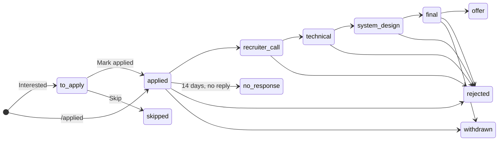

# Applications

[Overview](../how-it-works.md) · [Reference index](README.md)

How a job becomes an application and moves through its stages: matches from getjo, triage in New
offers, stages and their automatic tasks, comments, notes and the review order. The pages that show
all this are in [dashboard.md](dashboard.md); the tables are in [database.md](database.md).

## Contents

- [Matches from getjo](#matches-from-getjo)
- [Open and closed jobs](#open-and-closed-jobs)
- [Recording an application](#recording-an-application)
- [New offers triage](#new-offers-triage)
- [Feedback export for getjo](#feedback-export-for-getjo)
- [Stages](#stages)
- [Moving an application](#moving-an-application)
- [Stage tasks](#stage-tasks)
- [No response](#no-response)
- [Mark applied and Skip](#mark-applied-and-skip)
- [Tasks](#tasks)
- [Next action](#next-action)
- [Comments](#comments)
- [Notes](#notes)
- [Review order](#review-order)
- [The daily brief](#the-daily-brief)

## Matches from getjo

- getjo stores each job once in its `jobs` table with a score from 1 to 10.
- Hirey opens getjo's database read-only (`mode=ro`) on every request that needs it. It never writes
  to it and never imports getjo code; the `jobs` table shape is the only contract.
- A **match** is a job scored at or above a threshold (7 by default) whose id is neither in
  `applications.getjo_job_id` nor in `job_decisions` (`db.excluded_job_ids`). Unscored jobs never pass.
- `getjo.matches` feeds New offers, `/today` and the counts.

## Open and closed jobs

getjo adds `posted_at`, `expires_at`, `last_seen` and `closed_at` to its `jobs` table (getjo
docs/design.md, "Open and closed jobs"; all `YYYY-MM-DDTHH:MM:SSZ` UTC).

- `prep/getjo.py` builds its select list per connection from `PRAGMA table_info(jobs)`. On an older
  jobs.db the missing columns read as NULL, so every job reads as open and nothing else changes.
- `getjo.matches` leaves out a job with `closed_at` set or `expires_at` not after now, compared as text
  in the same stamp format (the dashboard uses noon UTC on a test's `today`).
- `getjo.get_job` and `jobs_by_id` return closed jobs too.
- `getjo.job_state` gives:
  - `closed`;
  - `may_be_closed`: `last_seen` more than `stale_days` (default 3) days before now;
  - `expires_in`: days left, when 7 or fewer (`getjo.EXPIRES_SOON_DAYS`).
- These show as chips in New offers and the offer panel, and as flags in `/today`.
- An Interested or Applied application whose job has closed or expired stays in the pipeline with a
  "closed" badge on its row and in its panel. Interview stages show none: the process goes on.

## Recording an application

`/applied` records an application from a getjo id, a URL, or a company and role.

- It looks the job up in getjo and stores the link (`getjo_job_id`), so the job drops out of the match
  list.
- The status is `applied` with `date_applied` today (unless `--date`), or `to_apply` (shown as
  "Interested") with `--status to_apply`.
- With a linked job it also writes an `applied` or `interested` row to `job_decisions`.
- Interested in an offer's panel, `/applied --job-id` and the old `/offers/apply` endpoint (no button
  any more) all go through `db.record_application`, so they behave the same way:
  - one application per getjo job;
  - never moved back to an earlier stage; an explicit `to_apply` never replaces a later status;
  - the job's Applications Assistant box messages move to the application
    ([assistants.md](assistants.md#job-messages-and-interested)).
- `add_application` (seed data, tests) adds no stage tasks.

## New offers triage

New offers triage writes `job_decisions`: one row per getjo job.

- The decision is `interested`, `applied` or `skipped`. A skip has a reason (`db.SKIP_REASONS`:
  location, seniority, role_type, stack, company, pay, contract_type, other) and an optional comment.
- The row copies the job's company, title, location, score, url and source at decision time, so the
  label still reads correctly after getjo drops the job.
- **Undo skip** deletes a skip row. An applied row is never undone there.
- **Undo after Interested** (`db.undo_interested`) deletes the decision and the `to_apply` application
  with its queued requests, in one transaction, so the job is new again. It runs only while nothing
  else has happened to the application: one history row; no tasks, comments, interviews, gaps, CV fit,
  tier, sessions or tailored copy; no request claimed by the agent; no messages written after
  Interested. Otherwise it is refused and the panel's Skip closes it instead.
- **Undo skip** on a job whose application was skipped from its panel ([below](#mark-applied-and-skip))
  deletes the decision and moves the application back to Interested in one transaction
  (`db.undo_skip`), so the job reads as interested again, not applied.
- Applications linked to a getjo job without a row (recorded before the table existed) count as
  applied when read (`db.job_decisions`).
- A job with a linked application reads its label from the live status: `interested` while it is
  `to_apply`, `applied` once it moves on (a skip stays a skip), whatever was stored, so each job has one
  label.
- These rows are the labelled data meant for tuning getjo's search.

## Feedback export for getjo

`python -m prep.cli feedback export` writes every decision, oldest first, to
`private_dir/feedback/job_decisions.jsonl` (or `--out`).

- One JSON object per line: `getjo_job_id, decision (interested / applied / skipped), reason, comment,
  decided_at, company, title, location, score, url, source`.
- Rows with no location or score take them from getjo (read-only) when it still has the job.
- The file is rewritten in full through a temp file and a rename, so a reader never sees half of it.
- getjo reads it with its own code (recent decisions as few-shot examples in its scoring prompt);
  Hirey never calls getjo. Comments are included, so they reach whatever prompt getjo builds from the
  file.

## Stages

| Stored value | Shown as | Closed |
| --- | --- | --- |
| `to_apply` | Interested | no |
| `applied` | Applied | no |
| `recruiter_call` | Recruiter call | no |
| `technical` | Coding interview | no |
| `system_design` | System design | no |
| `final` | Company interview | no |
| `offer` | Offer | yes |
| `rejected`, `no_response`, `withdrawn`, `skipped` | Rejected, No response, Withdrawn, Skipped | yes |

- `db.STATUS_LABELS` holds the labels; stored values and the `--status` choices are unchanged.
- Skipped closes an Interested application without applying. Withdrawn is pulling out of a live
  process. `db.move_application` accepts any stage, forward or back; the diagram shows the usual
  paths.
- A take-home test or a second interview is a comment, not a stage.
- The interview stages (`db.INTERVIEW_STAGES`) are recruiter call, coding interview, system design and
  company interview.
- Applications created before `status_history` existed have no history rows; their current status is
  the only known point.

## Moving an application

`/stage` turns a pasted recruiter email, call notes or a short message into commands:

1. Find the application (`cli apps`).
2. Run `cli update ID --status S [--interview-date D] --comment "summary"` (a short summary, never the
   whole email or pay).
3. Add extra to-dos with `cli task add --app ID`.

Every status change goes through `db.move_application`: the panel's Mark applied and Skip,
`cli update --status`, `cli skip`, `record_application` and the no-response check. It:

- writes a `status_history` row with the optional comment;
- sets `date_applied` the first time the application is sent;
- stores an interview date in `interviews` for the interview stages;
- calls `db.stage_tasks` ([below](#stage-tasks));
- applies only while the status is still the one it read, so two concurrent requests never move the
  same application twice.

`update_application` alone writes history but runs no stage tasks.

`cli update` to the stage the application is already in moves nothing but still saves the comment
(as a free comment) and, for an interview stage, the interview date (`db.set_interview_date`). When
that date differs from the stage's latest one, the stage's open auto tasks move to the day before it
(today if it has passed), so a rescheduled interview keeps its prep on time. Hand-made tasks keep
their dates.

The tier and employer kind change through the agent too: `cli update APP --tier X`,
`cli update ID --employer-kind product|client|unknown` (unknown clears it).

## Stage tasks

Entering a stage (`db.stage_tasks`, `db.STAGE_TASKS`):

1. closes the open auto tasks of other stages (status `closed`, which is not `done`: they drop off the
   to-do list without showing under Recently done);
2. adds the stage's tasks, skipping a title the application already has open (moving back into a
   stage creates fresh ones).

| Stage | Tasks added | Due |
| --- | --- | --- |
| Interested | none at once; research and CV fit are queued ([research.md](research.md)) | — |
| Applied | Chase if no reply; open Interested apply tasks are marked done | +7 |
| Recruiter call | Prepare for the call | day before the interview |
| Coding interview | Coding practice; Review the role's tech stack | day before the interview |
| System design | System design practice | day before the interview |
| Company interview | Prepare stories, company values, questions to ask | day before the interview |
| Offer | Review the offer | +2 |
| Rejected, No response | Debrief — what to improve (`db.DEBRIEF_TASK`) | +3 |
| Withdrawn | none | — |

- Interview-stage tasks are due the day before the interview date, today if that has passed, +2 days
  without a date.
- Interested gets no task: the job's panel shows the next step itself
  ([dashboard.md](dashboard.md#the-application-panel)). Until 27 Nov 2026 a "Review research and apply"
  task (`db.REVIEW_TASK`) followed the research and CV fit; open ones are still completed on Applied.
- Older "Apply" (+3), "Research the company" and "Check CV fit / tailor CV" tasks count as Interested
  auto tasks (`db.RETIRED_STAGE_TASKS`). Open ones stay as they are and close when the application
  moves on.
- Entering Interested also queues company research and a CV fit for the agent (the CV fit only when
  the application has none).
- Auto tasks carry their stage in `tasks.stage`. Tasks made before that column existed got it from
  their title when the column was added. Hand-made tasks have none and are never closed automatically.

## No response

- An application still in Applied whose last stage change is `no_response_days` (14) or more days old
  moves to `no_response` with the comment "auto: no reply in 14 days" (`db.auto_no_response`).
- The last stage change is the latest `status_history` row, else `date_applied`, else `created_at`.
- The Chase task (day 7) is closed and a Debrief task added.
- It runs on every dashboard request and in `prep.cli today`. The agent can move it back as usual.

## Mark applied and Skip

The panel's two direct actions, both only while the application is Interested.

- **Mark applied** (`/applications/apply`) moves it to Applied today through `db.move_application`
  (Applied stage tasks, `date_applied`).
- Its **Undo** (`/applications/unapply`, `db.undo_applied`) works only right after: the latest history
  row is applied, straight from to_apply. In one transaction it deletes that history row and the
  Applied stage's open tasks, reopens the apply tasks the move marked done, and clears `date_applied`
  unless the application had been sent before.
- **Skip** (`/applications/skip`, `cli skip APP --reason R [--comment C]`, `db.skip_application`):
  - takes a reason from `db.SKIP_REASONS` and an optional comment;
  - moves the application to `skipped` with the comment "skipped: <reason>[ — comment]";
  - closes its open tasks and agent requests;
  - for a getjo job, updates (or adds) its `job_decisions` row to skipped with the reason and comment,
    keeping the snapshot, so the job shows under New offers → Show skipped.
- Skipped is closed: never submitted, never a reply ([metrics.md](metrics.md)).

## Tasks

- `/task` adds, lists, completes, edits (`task edit`: title, due date) and deletes tasks.
- Task kinds: apply, prep, drill, admin. Statuses: todo, done, closed.
- Tasks can point at an application or a gap ([practice.md](practice.md)).
- The dashboard shows an application's tasks in its panel (tick to mark done). Tasks with no
  application are not on the dashboard; `/task list` and `/today` show them.
- The dashboard adds no tasks: the agent does (`cli task add`).

## Next action

- `applications.next_action` / `next_action_date` always hold the application's next open task (dated
  first, earliest first), set by `db.sync_next_action` whenever its tasks change.
- They are kept for older readers and no longer typed by hand; `--next-action` on `applied` and
  `update` adds a task instead.
- When `tasks.stage` is first added to an older database, each still-open application's typed next
  action becomes an admin task with its date (`db.next_actions_to_tasks`), so it keeps showing as due.
  The example data does the same.

## Comments

- A stage change can carry a comment (`status_history.comment`); free comments go to
  `application_comments`.
- `db.comments` merges both, newest first, each with a ref: `c<id>` for a free comment, `h<id>` for a
  stage change's comment.
- The panel lists them under its header (read-only); the pipeline list shows the latest with the count
  (`db.latest_comments`).
- The agent adds them (`cli comment`), lists them with refs (`cli comments list`, also in
  `thread show`), replaces the text (`comments amend REF`) or removes one (`comments remove REF`: a free
  comment is deleted; a stage change keeps its move and loses only the comment).
- `db.timeline` gives the stage changes for the panel's history.

## Notes

`applications.notes` is one Markdown text per application, written by the user and the agent:
questions to ask, notes from a call, what the agent finds.

- **Display.** The first card under Results in the panel (`web._notes_card`, always there on a tracked
  application, so Results always shows), rendered by `md.render_markdown(..., breaks=True)` (escaped,
  line breaks kept) with the agent's additions at the end.
- **Stamp.** `applications.notes_updated_at` (microseconds) moves on every notes write, never on a
  stage change.
- **User edit.** Edit opens a form (a `
`) with the text and the stamp. Save posts
  `/applications/notes` (`web.save_notes`); `db.save_notes` replaces the text in one conditional UPDATE
  only while the stamp still matches. Empty text clears it.
- **Conflict.** A stale stamp (the agent appended meanwhile) raises `db.NotesChanged`: the reply is a
  400 with the card again, the current notes above an open editor holding the user's text and the new
  stamp, so nothing is lost and a second Save is a deliberate overwrite.
- **Agent append.** `cli notes APP --append` (`db.append_notes`) adds a "**Agent · 17 Nov**" block at
  the end, never a rewrite, pay refused (`db.check_no_pay`).
- **Who appends.** `/ask` after a request to note something, a pasted recruiter email or call notes, or a
  debrief; `/research` appends "Questions to ask" after company research when the notes have
  none (`cli.has_questions_section`).
- `thread show` and `research next` print the notes as context. `cli update --notes` still replaces
  them (and moves the stamp). Notes text is never logged.

## Review order

`prep.cli review` (read-only; also inside the general `thread show`) prints the top 3 open tasks
(`cli.REVIEW_TOP`; `--all` for every one) and how many more there are.

The order is fixed (`db.review_tasks`, `db.REVIEW_GROUPS`):

1. overdue;
2. due today;
3. interview prep (tasks of the interview stages, nearest interview date first);
4. ready to apply (apply kind, such as "Review research and apply");
5. upcoming by due date;
6. undated.

- Ties go by due date and id.
- Each line has the group, due and interview dates, the task, its application (or "no application")
  and the task id.
- Then, separately, the agent's own open requests (research, CV fit, tailored CV), which wait on the
  agent, not the user.
- `/ask` answers "which tasks need me?" with those 3 in that order, each with its task id, so "done 1
  and 3" maps back, and lists the rest when asked.

## The daily brief

`/today` runs `python -m prep.cli today`. It:

1. runs the [no-response check](#no-response);
2. lists the applications it moved in the last 7 days (from their `auto:` history rows, so a move
   already made by the dashboard still shows);
3. lists the open tasks due today or earlier with their application;
4. opens getjo's database read-only and lists matches scored 7 or more, leaving out closed and expired
   jobs and flagging the rest "may be closed" or "expires in N days";
5. adds the queue lines (research, thread messages, drafts, job briefs, Learn messages; see
   [assistants.md](assistants.md#picking-up-queued-work)) and "Learn: X done, Y to do"
   ([learn.md](learn.md)).
