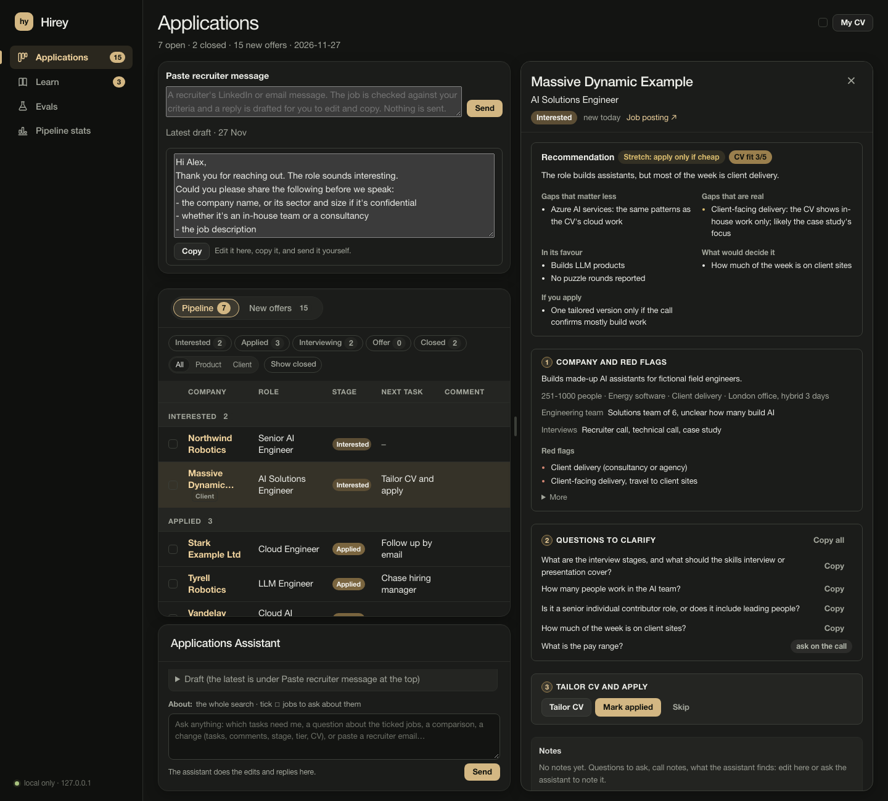
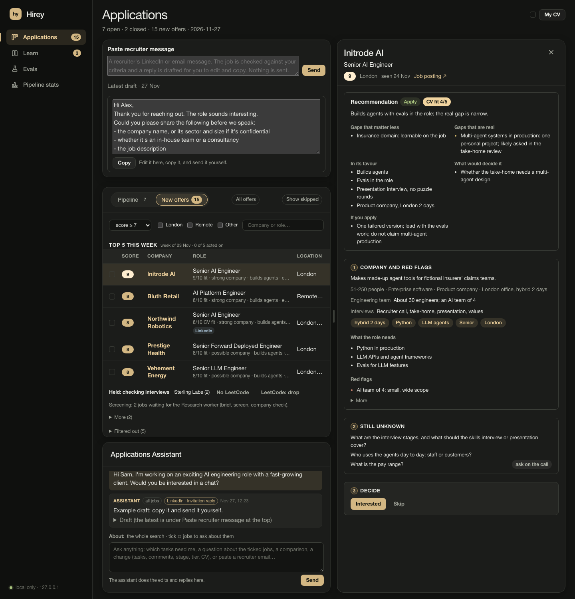

# Dashboard

[Overview](../how-it-works.md) · [Reference index](README.md)

The local web dashboard (`python -m prep.web`, `prep/web.py`): how it is built, how it stays safe, what
the script adds, and one section per page. Every endpoint is listed in [routes.md](routes.md).

## Contents

- [Server and rendering](#server-and-rendering)
- [Look and themes](#look-and-themes)
- [Local hardening](#local-hardening)
- [Forms without JavaScript](#forms-without-javascript)
- [What app.js adds](#what-appjs-adds)
- [Polling](#polling)
- [Applications page: Pipeline view](#applications-page-pipeline-view)
- [The application panel](#the-application-panel)
  - [Red flags and questions](#red-flags-and-questions)
- [Applications page: New offers view](#applications-page-new-offers-view)
- [The offer panel](#the-offer-panel)
- [Other pages](#other-pages)

## Server and rendering

- `prep/web.py` uses the standard library's `ThreadingHTTPServer`. `handle()` routes a request and
  returns (status, headers, body) without touching a socket, which is what the tests call.
- Each request opens a fresh prep.db connection (and a fresh read-only getjo connection: New offers,
  the pipeline's closed badges, the nav count), so the skills and the browser see each other's writes
  on the next request, without a restart.
- Every dashboard request runs the [no-response check](applications.md#no-response) first.
- Pages are built from plain strings by small helpers in `web.py`: app shell with a sidebar, cards,
  stat tiles, badges for status/tier/score/kind/due date, tables, buttons, empty states.
- Every database value is HTML-escaped and `applications.pay` is never shown. Agent-thread messages
  are shown verbatim, so they may contain pay the user pasted.
- Statuses are shown through `db.status_label` (`db.STATUS_LABELS`): `to_apply` reads "Interested" in
  badges, charts and CLI output; the stored value and the `--status` choice stay `to_apply`.
- Charts come from `prep/charts.py`: server-rendered inline SVG (funnel, columns, stacked columns,
  share bar, trend) coloured by shade-step CSS classes, so they need no script and no inline style,
  and every label is escaped.
- The site is branded "Hirey" in the page title and sidebar. The nav shows the new offers count next
  to Applications and the Learn cards to do on every page; the sidebar holds the
  [Workers](assistants.md#workers-sidebar-and-run-history) section.

## Look and themes

Static files are served from `prep/static/`: `style.css`, `app.js`, `vim.js` (Learn editor), and
`explainer.css` / `explainer.js` (Learn explainer pages).

- `style.css` holds the design tokens: one dark grey theme where each page has its own muted hue:
  Applications ochre, Pipeline stats dusty blue, Learn dusty
  violet, Evals eucalyptus
  (`web.PAGE_THEMES`).
- More themes (slate indigo, mauve rose, terracotta) are ready for new pages.
  Each is ten shades `s1`–`s10`, set by a `theme-*` class on `<body>` and used by badges, charts,
  buttons and meters.
- Installed Helvetica Neue-style fonts only; responsive down to phone width.

## Local hardening

- The server binds to `127.0.0.1`; `serve()` refuses any other address.
- Requests whose Host header is not `localhost` or `127.0.0.1` (with any port) are rejected, which
  blocks DNS rebinding.
- POSTs with a cross-origin `Origin` (including `null`) or `Sec-Fetch-Site` are rejected.
- `Referrer-Policy` is `same-origin`, not `no-referrer`: under `no-referrer` browsers send
  `Origin: null` on plain form posts, which that check would refuse.
- The Content-Security-Policy allows only same-origin files (`script-src 'self'`, no inline script or
  style), plus `frame-src 'self'` for Learn explainers. Nothing is fetched from another host (no CDN,
  fonts or chart libraries).
- Pages served with their own headers: the tailored CV PDF ([cvs.md](cvs.md)) and the Learn explainer
  ([learn.md](learn.md)), and a saved promptfoo report ([evals.md](evals.md#the-promptfoo-report)).
- Logs hold the request line and status only, never request bodies or skip comments.
- The dashboard makes no outgoing requests; job links open only when clicked. Its only outgoing
  action is the optional local [`dev3 message`](assistants.md#the-ping).

## Forms without JavaScript

- Forms post and then redirect (303) back to the page. Forms carry a `return` field so the redirect
  keeps the view, filters and panel.
- `return` is accepted only for `/`, or an old `/offers`, `/matches`, `/applications` or `/tasks` URL,
  which is mapped as its GET redirect is; its query is re-encoded.
- The redirect shows a fixed confirmation (`web.MESSAGES`, the URL carries only the key; the script
  turns it into a toast). Bad input gets a 400 page with the reason.
- The Skip links open `GET /offers/skip` or `GET /applications/skip`: a plain form (reason select +
  comment) that changes nothing until posted.

## What app.js adds

`app.js` is an enhancement only; every page works without it.

**View memory.**

- On a bare `/` (no query at all) it opens the view last picked with the switch and the jobs last
  ticked in this browser (`localStorage` `apps-view` and `apps-sel`, read and written in try/catch;
  one `location.replace`, never a loop). Any URL with a query says what to show and is left alone.

**Ticks.**

- A tick toggles in place: the URL changes with `replaceState`, every ☐ for that key and every form's
  `return` follow, and only the Applications Assistant box's About line is fetched again (the list
  keeps its scroll). A fifth tick shows a toast instead.
- Opening a panel keeps the ticked jobs (`withSel`) and ticks the opened one only when nothing is
  ticked.

**Panels.**

- It opens a side panel (an application's or a job offer's) without a reload: it fetches the
  `?app=ID` or `?job=ID` page, swaps in its panel and the box's About line, and pushes the URL. A
  message being typed stays.
- Esc and ✕ close it, which also turns About back to the whole search.
- A message's tag opens its application or offer panel, and swaps the list too when the tag points at
  the other view.
- getjo ids hold ":" and other characters, so rows are found with `CSS.escape`d attribute selectors.
- A folded job description gets a Show all button. Table headers become sortable.

**Refresh.**

- After any change on the page (an agent reply, finished agent work, Interested, Mark applied, Skip,
  Undo skip, a ticked task, an Undo) it fetches the page again and swaps in the list card, the panel,
  the conversation, the subtitle and the nav count (`refreshApps`), keeping the panel's scroll
  position.
- A done shortcut button scrolls to its result card.

**Forms.**

- It sends forms marked `data-ajax` with `fetch` and `Accept: application/json`. For such requests
  POST endpoints answer JSON (`{"ok": true, "message": …, …}` or `{"ok": false, "message": …}` with
  status 400) instead of a redirect; `html` is server-rendered and escaped. Results show as toasts.
- It sends the box's message with `fetch` (Cmd/Ctrl+Enter also sends), swaps in the returned
  conversation and filters it to the ticked jobs when Selected is chosen.
- **Undo toasts.** Interested in an offer's panel opens the reply's `redirect` (its application panel,
  Pipeline view) and offers Undo, which posts `/offers/uninterested` and goes back to the offer; Undo
  is offered only when the reply says `created`. Mark applied offers Undo (`/applications/unapply`); a
  ticked panel task offers Undo (`/tasks/reopen`); a skipped offer gets Undo (`/offers/unskip`).
- **Skip dialog.** A Skip link (an offer panel's, an Interested application panel's) opens the one
  `<dialog>` on the page, with a button per skip reason and a comment box. The link's
  `data-skip-action` and `data-skip-field` say where it posts and which hidden field its `data-skip`
  fills (`/offers/skip` and `job_id`, or `/applications/skip` and `app_id`). It posts the clicked
  reason (`FormData(form, submitter)`), then refreshes.
- **Notes card.** Its form (`data-notes`) posts with `fetch` and swaps in the card from the reply's
  `html`, on success and on a stale refusal alike; Cancel closes the editor and restores the saved
  text. While its editor is open, a refresh of the panel keeps that card as it is, text and stamp.

**New offers filters.** Listeners sit on the document, since the list is swapped in again:

- a select or checkbox reloads with the new query;
- the search narrows the loaded rows (company or role) as one types and updates the URL and the
  forms' `return`; a search wider than the one the server rendered (the box's `defaultValue`) reloads
  after a pause, keeping the cursor in the box;
- "/" focuses it.

## Polling

- While a message is pending, or the open panel's application has open agent requests (research, CV
  fit, tailored CV) or its job has a brief being written (the panel's `data-busy`), `app.js` polls
  `GET /applications/thread[?app=ID | ?job=ID]`.
- Every 4 seconds for 5 minutes, then every 30 seconds until it is done or Stop is pressed (the
  waiting line then says so, keeping Stop; one poll; opening or closing a panel restarts it).
- When nothing is pending any more it refreshes everything: "The agent replied." when the message
  count changed, else "The agent's work is in."
- The JSON is `{ok, pending, status, messages, html}` (404 for an unknown id). `status` is the open
  panel's application's, null without one; `messages` is the conversation's count, so the script can
  tell a reply from finished work; `html` is the box's conversation. `pending` is true while any
  message waits or (with `app`) an agent request for that application is open.
- The Learn page and the Workers sidebar poll on their own ([learn.md](learn.md),
  [assistants.md](assistants.md#workers-sidebar-and-run-history)).

## Applications page: Pipeline view

`/` is the Applications page. A switch at the top of the left column, Pipeline N · New offers M
(`view=pipeline|offers`, links), picks the list. The [Applications Assistant box](assistants.md#applications-assistant-box)
sits under the list, and the side panel on the right.

**Layout.**

- From 801px wide: list and panel half and half with a divider between them (`web.SPLIT_HANDLE`, a
  `role="separator"` that `app.js` drags or moves with the arrow keys, Home/End, and Enter or a
  double-click for half and half).
- Divider limits: minimum 360px list, 420px panel; kept per browser in `localStorage` as `apps-split`
  and applied as the `--split-l`/`--split-r` grid fractions; shown only with the script, from 801px and
  while a panel is open.
- From 801px the page is exactly the viewport's height and does not scroll: the list card takes at
  most 45% of the left column and scrolls its rows inside while the switch, the stage strip or offer
  filters and the column headings stay; the box fills the rest with its messages scrolling and its
  input always in view; the panel scrolls inside.
- Up to 800px everything stacks, and the panel is a full-screen sheet.

**Query string.** The page state is in the query string, so every view renders without the script.

| Parameter | Effect |
| --- | --- |
| `app=ID` | opens the panel (an unknown id is ignored; it wins over `job=`) |
| `stage=interested\|applied\|interviewing\|offer\|closed` | filters (`web.STAGE_GROUPS`; the four interview stages share Interviewing) |
| `closed=1` | lists the closed applications too (Show closed / Hide closed) |
| `employer=product\|client` | keeps only that employer kind; the stage strip's counts follow it, the Pipeline count does not |
| `sel=…` | ticked targets ([assistants.md](assistants.md#ticks-and-targets)) |
| `cv=1` | opens My CV ([cvs.md](cvs.md)); wins over `app`/`job` |

Unknown values and an old `view=board` are ignored. `/applications` and `/tasks` redirect here with
their query.

**Stage strip.** The count per group, each linking to its filter (the active one clears it).
All · Product · Client sits beside Show closed.

**The list** (`web._app_list`) is one table with a `<tbody>` per stored stage in pipeline order
(`web.PIPELINE_STAGES`, then `web.CLOSED_LANE` when shown), each with a header row and its count.

- Order within a stage: dated next tasks first (earliest first), then undated, then none; ties by days
  in stage (`web.list_order`). Then regrouped product, unknown, client by `applications.employer_kind`,
  with that order kept inside each group (`web.employer_order`).
- Columns: Company (a link to the panel, with a small Product or Client label under it; none while
  unknown), Role, Stage (a short label such as Coding or Sys design, the full one on hover:
  `web.LIST_STAGE_LABELS`), Next task, Comment (the latest, one line, with "+N" when there are more).
- An Interested or Applied row whose getjo job has closed or expired shows a "closed" badge under the
  role.
- Company, role and next task wrap to two lines at most. Each row starts with its ☐ tick.
- No board, no drag and drop, no due, days, fit or tier columns.

## The application panel

A decision page: it answers what the company is and which red flags the job shows, what to clarify on the
recruiter call, then Tailor CV and apply. Top to bottom (`web._panel`):

1. **Header**: company, role, stage badge with interview step dots, "N days in this stage", the job
   posting link, the "closed" badge when it applies, ✕ to the same view without `app`.
2. **Recommendation** (`web._recommendation`), from the CV fit's "## Recommendation" section: the verdict
   (Apply, Stretch: apply only if cheap, Skip) with its sentence and the CV fit score, then short lists:
   gaps that matter less, gaps that are real, in its favour, what would decide it, if you apply
   ([research.md](research.md#the-recommendation)). "Written with the CV fit…" while the fit is queued.
3. **1. Company and red flags** (`web._decide_company`): what the company does, one facts line (size,
   sector, "Product company" or "Client delivery", where), the engineering team and the interview style,
   the job brief's key facts and "What the role needs" (its Must-haves), the CV fit badge, then the red
   flags ([how they are built](#red-flags-and-questions)). "Researching…" while the company research or
   the brief is being written. **More** holds the full brief (with Write brief / Redo brief and Show
   original), the company research card and the CV fit card, each with Open and Redo.
4. **2. Questions to clarify**: the questions for the recruiter call, each with Copy, and Copy all; the pay
   question is marked "ask on the call" and is never copied. Under them the latest reply draft (editable,
   with Copy) and, for an application from a recruiter's invitation, the **LinkedIn invitation** card: its
   gate line, Top 5 rank and reply draft ([search.md](search.md#recruiters-invitations)).
5. **3. Tailor CV and apply**: Tailor CV (always a plan first; "Planning…" / "Tailoring…" while open), Mark
   applied and Skip while Interested, afterwards a disabled "Applied · 3 Nov" or "Skipped"
   ([applications.md](applications.md#mark-applied-and-skip)); then the Tailoring plan and Tailored CV
   cards ([cvs.md](cvs.md)).
6. Quiet: the Notes card ([applications.md](applications.md#notes)), the latest comment (read-only) and the
   stage history, collapsed.

Opening the panel of an open application queues its company research, CV fit and job brief **once** when
they are missing (`web._research_on_open`, `db.requested_kinds`): never when one was ever asked for, and no
research when the company has a profile or another application at it has research queued. A fit written
while the job was an offer is taken over (`db.adopt_job_fit`). It never changes the application.

The panel has no tasks, no Draft a reply form, no Employer select and no "Ask about this" tick (removed on
27 Nov 2026: the row's tick does that, the employer kind comes from the research, a follow-up or thank-you
note is asked in the Applications Assistant box). Its only forms are Notes, the plan and CV editors and the
buttons above; tasks, comments, stage, tier and the sent CV are changed through the Applications Assistant.

### Red flags and questions

`prep/decision.py` builds both in plain code from what is stored:

- **Red flags**: a gate that says no (level, location, interview style, sector, role family, a stated pay
  below the floor), team size (a team of one; an unclear team once the ad is screened), client delivery,
  a contract, the research's `red_flags` and the brief's "## Red flags / notable" bullets, duplicates
  dropped. Team size is never a gate ([search.md](search.md#the-criteria-file)).
- **Questions** (about 4-6, recruiter-call level, never technical): a fixed template where the answer is not
  known (interview stages and what to prepare always; AI team size; office days unless the key facts or
  the research say; the product without a research summary; the level), up to two of the research's
  `call_questions`, and pay last, call only.

`python -m prep.cli thread show APP` prints both for the Applications Assistant.

## Applications page: New offers view

`/?view=offers` (the old Job Offers page) is the left column's other view. The panel, box and layout
are shared with the Pipeline view.

- **Top 5 this week** (with a criteria file, default filters): the week's picks with a why line each and
  the outcome once acted on, then Held: checking interviews (one click per company), Screening (a count),
  More and Filtered out (folded). All offers (`all=1`), a search, a location box or another score shows
  the plain list. Rules: [search.md](search.md).
- **Rows** (the plain list): open getjo jobs ([applications.md](applications.md#open-and-closed-jobs)) at or above
  `score` that are neither tracked nor decided (`db.excluded_job_ids`; decided jobs live in the
  pipeline), newest day first (`first_seen`), then highest score (`web.offer_rows`).
- Each row: its ☐ tick, score, company (a link to the offer panel), role with the chips (closed, may be
  closed, expires in N days) and location. The whole row opens the panel.
- The switch's count and the nav count are the open new offers at the score in effect, ignoring
  location and search (default 7, as `/today`).
- If getjo's database is missing or unreadable, a message shows instead of the list; the pipeline
  still works.

**Filters** in the list header, a GET form:

| Parameter | Effect |
| --- | --- |
| `score` | 1–10, default 7; unscored jobs never pass |
| `loc` | repeatable: london, remote, other (`getjo.location_tags`) |
| `q` | company or role, case-insensitive substring |
| `skipped=1` | Show skipped / Hide skipped |
| `all=1` | All offers: the plain list instead of Top 5 |
| `job=<getjo id>` | opens the offer panel |

- Location tags: the word "london"; the words remote/anywhere/work from home/wfh; neither or empty is
  other. A job can be both.
- `skipped=1` lists the skipped jobs instead, at any score, open or closed, latest skip first, with the
  reason, the comment and Undo skip. A skipped job getjo has dropped shows from its snapshot.
- `/offers` and `/matches` redirect here with their query mapped: `company`/`role` to `q`,
  `show=skipped` to `skipped=1`, `show=interested|applied` to the pipeline's `stage`.

## The offer panel

`job=<getjo id>` opens it. A tracked job opens its application's panel instead; an unknown id is
ignored. It is the research and decision stage only: everything on it helps decide whether the role is
interesting.

- Header: company, role, score, location, seen date, the posting link (http(s) only), the chips.
- The **Recommendation**, **1. Company and red flags** (with "What the role needs") and More (the brief or
  the description from getjo made readable, `getjo.job_description`, read-only, escaped; no Write brief or
  Redo button), as in the application panel. The company research is shared by every job at the company.
- **2. Still unknown**: the same questions, read only (no Copy until it is Interested).
- **3. Decide**: Interested · Skip; a skipped job shows "Skipped · reason" and Undo skip.
- Opening it queues the job brief with its screen, the company check, the company research and the CV fit
  with its recommendation, once, keyed by the job id (`web._queue_briefs`, `db.queue_job_fit` for an offer
  briefed before job fits). Nothing is tracked and no status changes; Interested hands the fit to the new
  application.
- Interested (`/offers/interested`) and `/offers/apply` redirect to `/?app=ID` (JSON: `redirect`,
  `app_id`, `created`), built from the application id only; skip and unskip return to the `return`
  URL.

## Other pages

| Page | Path | Reference |
| --- | --- | --- |
| My CV panel | `/?cv=1` | [cvs.md](cvs.md) |
| Research file | `/research/file?app=ID&kind=…` | [research.md](research.md) |
| Tailored CV PDF | `/research/pdf?app=ID&v=N` | [cvs.md](cvs.md) |
| Learn | `/learn` | [learn.md](learn.md) |
| Evals | `/evals` | [evals.md](evals.md) |
| Pipeline stats | `/stats` | [metrics.md](metrics.md#pipeline-stats-page) |
| Run history (not in the nav) | `/runs` | [assistants.md](assistants.md#workers-sidebar-and-run-history) |

Old URLs (`/metrics`, `/metrics/runs`, `/dashboard`, `/progress`) redirect ([routes.md](routes.md#redirects-from-old-urls)).
