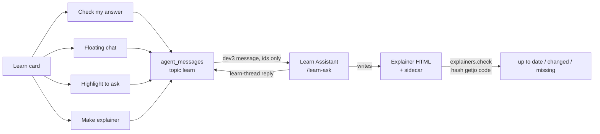
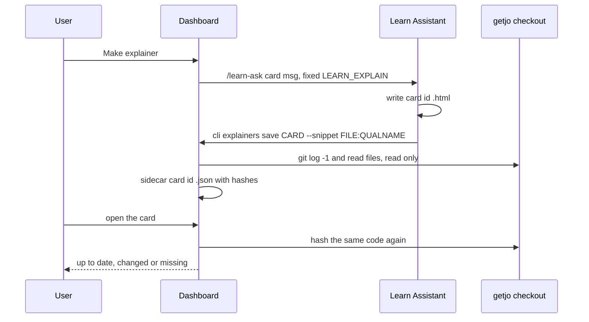

# Learn: cards, notes, Learn Assistant and explainers

[Overview](../how-it-works.md) · [Reference index](README.md)

The Learn page (`/learn`) holds interview-prep flashcards in tracks and chapters, private notes per
card, a second assistant conversation (the Learn Assistant) and optional explainer pages per card.

## Contents

- [Tracks, chapters and cards](#tracks-chapters-and-cards)
- [Card commands](#card-commands)
- [Import and gap cards](#import-and-gap-cards)
- [Learn notes files](#learn-notes-files)
- [The Learn page](#the-learn-page)
- [Notes editor and Your answer](#notes-editor-and-your-answer)
- [Learn Assistant](#learn-assistant)
- [Add to notes: the essence of a reply](#add-to-notes-the-essence-of-a-reply)
- [Explainers](#explainers)
- [Floating window and highlight to ask](#floating-window-and-highlight-to-ask)
- [Endpoints](#endpoints)



## Tracks, chapters and cards

Tables: [database.md](database.md#learn).

- **Tracks** hold flashcards in order. Each has a slug, title, subtitle and a cover colour key
  (`learn.TRACK_COVERS`).
- **Chapters** split a track.
- **Cards** hold:
  - the question (`front`);
  - an optional `prompt`: Markdown shown under the question, always visible (the code a "read the
    code" card asks about);
  - key points in Markdown (`back`);
  - tags and likely follow-ups (JSON lists of strings);
  - sources: a JSON list of `{kind, title, url, minutes, why}`, kind `watch`, `read` or `notes`;
  - an optional `source_gap_id`;
  - a status, `todo` or `done` (`learn.CARD_STATUSES`), with `done_at`.
- There is no schedule and no due date: progress is cards done out of all.
- Allowed values are checked in `prep/learn.py`.
- Card content (real answers, stories) stays in prep.db. Fixtures hold one fictional track with three
  cards.

### Source ticks

A source is ticked done on its own (`card_source_done`: card_id, source_key, done_at;
`learn.set_source_done`, `learn.source_progress`).

- The key is the source's URL, else `kind:title` (`learn.source_key`). An import that reorders or edits
  other sources keeps the ticks.
- Only ticks matching a current source are counted.
- Ticks never change the card's own status.
- `learn.delete_card` removes them with the card.

## Card commands

All run as `python -m prep.cli …`.

| Command | What it does |
| --- | --- |
| `tracks add` | Adds a track. |
| `tracks list` | Each track's chapters, "done X / Y" and the percent done. |
| `cards add` | A JSON card or a list on stdin (or `--file`); adds all or none (`learn.add_cards`). |
| `cards list [--track T] [--todo \| --done]` | Cards in track, chapter and card order. |
| `cards show ID` | One card, with `[x]` / `[ ]` before each source and "N / M done". |
| `cards done ID` / `cards undo ID` | Marks it done, or back to do (`learn.set_status`). |
| `cards delete ID` | Removes a card (`learn.delete_card`). |
| `cards import FILE [--dry-run]` | Markdown import ([below](#import-and-gap-cards)). |
| `cards gaps [--gap ID] [--app ID] [--session ID] [--limit N]` | Read-only JSON drafts for open gaps. |

`cards add` names the track by id or slug and the chapter by title (added when new). A new card is to
do.

`/today` prints "Learn: X done, Y to do" with "done/all" per track whenever any card exists.

## Import and gap cards

### Markdown import

`cards import FILE [--dry-run]` reads a Markdown file in the format of
[learn-format.md](../learn-format.md):

- `#` track, `##` chapter, `###` card front, the back, then `tags:`, `gap:`, `follow-ups:` and
  `sources:` lines;
- text above a card's first `---` line is its prompt;
- code fences (three backticks) are card text, so a `---` inside one does not split.

`learn.parse_markdown` parses it; `learn.import_markdown` adds or updates everything in one
transaction.

- A track is matched by slug, a card by track and front.
- A match takes the file's prompt, back, chapter, tags, follow-ups, sources and gap, and keeps its id,
  position and status. A second import of the same file changes nothing.
- Cards missing from the file are kept and counted.
- `--dry-run` rolls back and prints the same counts.
- Real import files are private (`private_dir/learn/`, gitignored); `learn.example.md` is a fictional
  one.

### Gap cards

Gaps ([practice.md](practice.md#gaps-and-drill-tasks)) become cards in two steps:

1. `cards gaps` is read-only. It prints JSON drafts for open gaps with no card: track `gaps-to-drill`,
   chapter the application's company, front the gap, an empty back, `source_gap_id`.
2. The agent writes the backs, shows them, and saves with `cards add` only after the user says yes.

- `learn.add_card` refuses a second card for the same gap, and creates the "Gaps to drill" track with
  its first card.
- `/debrief` asks in the chat; `/mock` ends with a `— Gap cards · session #S` line and `/ask` saves on
  the user's "save cards" reply.

## Learn notes files

`prep/learnnotes.py`. Private Markdown files under `private_dir/notes/learn/` (gitignored, and caught
by `prep/privacy.py`'s `notes/*`):

| File | What it is |
| --- | --- |
| `card-<id>.md` | One per card. |
| `all-prep.md` | One general notebook. |
| `answer-<id>.md` | The user's own answer to a card (the card's Your answer box). |

Rules:

- A file name comes from a card id, `all` or `answer-<id>` only, never from raw input.
- The **stamp** is a short SHA-256 of the file's text; a missing file is the empty text.
- `learnnotes.save(key, text, stamp)` writes only when the file still has `stamp`, else raises
  `NotesChanged`. Line ends become `\n`, with one final newline; the write is atomic (a temp file,
  then a rename).
- `learnnotes.append` adds a dated "**Agent · 18 Nov**" block at the end (`db.notes_block`), never a
  rewrite; pay is refused.
- Both hold an `flock` on `notes/learn/.lock`, so the check and the write are one step.
- Answers are never appended to (`learnnotes.append` and the CLI refuse).
- At most 60,000 characters per note. Notes text is never logged.

Agents use `cli learn-notes CARD_ID|all [--show | --append [TEXT]]` (stdin when TEXT is left out) and
read answers with `cli learn-notes answer CARD_ID --show`.

## The Learn page

### Header and nav

- Subtitle: "X done · Y to do" (`learn.counts`) and the next interview on or after today
  (`db.next_interview`: company, stage, day).
- The nav's Learn badge is the cards to do, on every page.

### Overview: `/learn`

Without `card` or `track`:

- a grid of tracks (`learn.list_tracks`): a cover gradient class per `learn.TRACK_COVERS` key, a
  progress ring (SVG with `pathLength` and `stroke-dasharray` attributes, no inline style), title,
  subtitle, chapters · cards, "X done / Y";
- then the Learn Assistant box for general messages ([below](#the-general-box)).

### Track: `/learn?track=SLUG|ID`

Opens the track's first card to do, else its first card (`learn.first_card`). A track with no cards
shows the grid with a notice.

### Card: `/learn?card=ID`

The tracks again as a compact row (`.tracks-row`; the card's track is `.is-current` with
`aria-current`), then the card view (`web._learn_view`):

- the card at full width;
- its Explainer under it (`web._explainer_section`, [Explainers](#explainers));
- the floating window (`web._learn_float`: Assistant | Notes tabs holding `web._learn_agent` and
  `web._notes_body`; [Floating window](#floating-window-and-highlight-to-ask)).

An unknown or malformed id is a 404.

### The card itself

Top to bottom:

- track · chapter, "Card N of M" with ← → links, tags;
- the question (escaped, line breaks kept);
- the prompt when the card has one (`.learn-prompt`, through `prep/md.py`, always visible);
- Your answer ([below](#your-answer));
- Show answer: a `<details>` with the back through `prep/md.py` without links, and the follow-ups;
- the Learn box, outside the fold (`web._learn_sources`, `#learn-sources`):
  - "Learn · N / M done";
  - each source with a tick form (`.tick` button, `role="checkbox"`) posting the state wanted;
  - ticked rows are `.is-done`: muted and lightly struck through;
  - links through `_link`: http(s) only, new tab;
  - left out when a card has no sources;
- Done / Not done yet forms.

### Done and Not done yet

- `/learn/done` marks the card done and redirects to the next card to do in the track after it,
  wrapping round (`learn.next_todo`), or to `/learn` with "Every card in that track is done".
- `/learn/undo` puts it back to do; the card stays open.
- `/learn/source` ticks or unticks one source. An unknown key is a 400. JSON replies add `html` (the
  Learn box), which `app.js` swaps in (`data-ajax="source"`), keeping focus on the tick.

## Notes editor and Your answer

### Notes (`web._notes_body`)

In the floating window. Tabs "this card" (`card=ID`) and "all prep" (`&notes=all`) are links. Without
`private_dir`, Notes says so.

The editor (`web._notes_editor`, a form):

- a line-number gutter: one number per logical line, each as tall as that line's wrapped rows
  (`app.js` measures them in a hidden mirror with the textarea's width, again on resize);
- a monospace textarea that soft-wraps to the panel (no sideways scroll), about 13–15 lines tall
  (`clamp(200px, 34vh, 340px)`; in the floating window up to 46vh); escaped, with one leading newline
  the parser drops;
- the note's stamp;
- a status line: mode, the `notes/learn/…` file, save time, line,col, the vim keys toggle.

### Autosave (`autosaving()` in `app.js`)

Shared with Your answer.

- Saves 1.5 s after the last change, on blur and on Cmd/Ctrl-S, posting as JSON.
- Sends a last save with `sendBeacon` on `pagehide`.
- A refused save whose current note starts with the text the editor last had (an agent append) is
  merged, the addition below the user's text, and saved again.
- Any other change pauses autosave and shows the current note; the next explicit save replaces it.
- Coming back to the tab with nothing unsaved fetches `GET /learn/notes?card=ID[&note=all]` (text and
  stamp) and picks up an addition.

A stale stamp on `POST /learn/notes` is a 400 whose JSON adds `html` (the editor or answer box with
the user's text under the current note), `stamp` and `text` (the current note). Plain form posts
redirect to the tab.

### Vim keys

- `static/vim.js` is pure key handling: `HireyVim.step(state, key)` → state, handled, save, changed.
  It is tested under node by `tests/vim_test.js` when node is installed.
- `app.js` feeds it keydowns and shows the normal-mode cursor as a one-character selection.
- Off by default; kept as `learn-vim` in `localStorage`.

### Your answer

`web._answer_box`, on the card between the question and Show answer:

- a plain textarea from six rows that `app.js` grows with its text;
- saved by the same `autosaving()` (note `answer`), with "saved HH:MM";
- no vim keys;
- left out without `private_dir`.

## Learn Assistant

A second conversation in `agent_messages`, answered by the dev3 task in `prep_assistant_task`
through the `/learn-ask` skill. The shared message mechanics (claims, leases, Resend) are in
[assistants.md](assistants.md).

### Storage and separation

- Rows have topic `learn` (`db.LEARN`, set by `db.add_learn_message` only, never taken from a form)
  and `card_id`: the card open when the message was sent (NULL: prep in general).
- A reply copies the question's topic and card.
- Every reader of the Applications conversation leaves them out:
  - `db.thread()` and `db.pending_messages()` without `topic="learn"`;
  - `db.message_count()` without `learn=True`;
  - `thread pending`;
  - `_thread_line` (`today` and the SessionStart `queue`), which print their own
    "Learn Assistant: N messages waiting. Run /learn-ask." line instead;
  - `thread show --message` hands a Learn message to `learn-thread show`.

### What stores a message

| Post | Stores |
| --- | --- |
| `/learn/message` (`card_id`, `body`) | The user's message. |
| `/learn/check` (`card_id`) | The fixed `db.LEARN_CHECK` (Check my answer). Refused while `answer-<id>.md` is empty; the script saves the answer first. |
| `/learn/card` (`reply_id`) | `db.LEARN_CARD` naming a Learn Assistant reply (Want a card for this?). |
| `/learn/explainer/make` | `db.LEARN_EXPLAIN` ([Explainers](#explainers)). |
| `/learn/explainer/refresh` | `db.LEARN_EXPLAIN_REFRESH`, naming what changed. |

### The ping

Each one pings `prep_assistant_task` in a background thread with `assistant.learn_command`:

```
dev3 message --task seq:<N> [--project …] --subject "Learn question on card <id>" "/learn-ask <card id|general> <msg id>"
```

Ids only, never the text.

### The /learn-ask skill

`.claude/skills/learn-ask/SKILL.md`. It reads a message with `cli learn-thread show MSG --claim`,
which prints:

- the card's front, back, follow-ups, tags and Learn sources;
- the track's chapters with card ids, for quiz mode;
- the paths of `stories.md`, the facts bank, `notes/interview-coaching.md` and the card, answer and
  all-prep notes;
- the latest 30 Learn messages.

It answers with `learn-thread reply --to MSG`. A card it drafts is saved with `cards add` only after
the user's yes in the box. `learn-thread pending` lists waiting messages.

### The box

`web._learn_agent`, `web._learn_thread`:

- the latest 60 Learn messages, oldest first;
- each tagged with its card: a link showing the card's question cut to about 50 characters, the whole
  question as its title (from `learn.fronts`); "this card" for the open one; "a removed card", not a
  link, for a deleted one;
- Want a card for this? and Add to notes under each agent reply.

While a message waits, `app.js` polls `GET /learn/thread?card=ID` (pending, count, HTML) every 4 s for
up to 5 minutes, then swaps the conversation in and tells the Notes editor to pick up an agent's
addition (`learn:refresh`).

### The general box

The Learn overview (`/learn` without `card`/`track`) shows the same box under the tracks
(`web._learn_agent(…, None)`, `.learn-general`):

- its form has no `card_id`, so the message is stored with `card_id` NULL;
- it is pinged as `/learn-ask general <msg id>` and redirects to `/learn`;
- the poll asks `/learn/thread?card=` (no card).

### Stop, Resend and Cancel

The shared mechanism is in [assistants.md](assistants.md#resend-and-cancel). On the Learn side:

- While a Learn message waits, the waiting line has Stop: `POST /learn/stop` (optional `card_id`, for
  the page to go back to) calls `db.cancel_waiting_messages(conn, learn=True)`. It cancels every
  waiting Learn message, never an Applications one; Applications Stop never touches a Learn one. Rows
  are kept.
- `POST /learn/resend` (`msg_id`, `card_id`) re-pings with `assistant.notify_learn`.
- `POST /learn/cancel` cancels one message.
- `learn-thread show MSG` on a cancelled message prints "was cancelled by the user … Do nothing",
  and /learn-ask does nothing.

## Add to notes: the essence of a reply

`POST /learn/add-note` (`reply_id`) appends the essence of that reply to its card's note (all-prep for
a general one), with `learnnotes.append` on the server.

`learnnotes.essence` picks the text:

1. the reply's last "Understand:" line that a "Say it:" line follows, up to the blank line or "—"
   footer after "Say it:", kept as written (an optional "Fix:" part, any code snippets, blank lines
   and indentation);
2. else an older reply's last "Better phrasing:" text as "Understand:" and its "Say it in the
   interview:" line as "Say it:", either alone;
3. else nothing: a 400 with `web.NO_SUMMARY`, which `app.js` shows as a `.msg-hint` line under that
   reply's buttons. Never the whole reply.

It goes under a heading with the card's question and the day ("Agent" for a general one). It is
refused when that text is already there or mentions pay. The pay check skips only the old "Bonus for
the interview:" label at the start of a line (now "Extra for the interview:").

## Explainers

An explainer is a private HTML page per card, `private_dir/learn/explainers/<card id>.html`, written
by the Learn Assistant with `.claude/skills/explainer/SKILL.md`.



### Asking for one

- `POST /learn/explainer/make` stores `db.LEARN_EXPLAIN`; `POST /learn/explainer/refresh` stores
  `db.LEARN_EXPLAIN_REFRESH`, naming what changed.
- Both are fixed messages built from ids and the check, pinged like Check my answer.

### The page

It loads only `/static/explainer.css` (Hirey's dark tokens, the Learn violet, built/partial/gap
pills, code with numbered notes) and `/static/explainer.js`, plus its own small inline script.

### Recording what it quotes

After writing it the agent runs `cli explainers save CARD --snippet FILE:QUALNAME ...`.
`explainers.record` writes the sidecar `<card id>.json` with:

- getjo's HEAD (`git log -1`, read only);
- per snippet: the file, the function and the sha256 of its code now, located with `ast` (a dotted
  qualname, decorators included; no qualname: the whole file).

A file outside the checkout or a function that is not there is refused.

### The staleness check

`explainers.check` runs on every card view, and as `cli explainers check [--card ID]` (exit 1 when any
is not up to date). It hashes the same code again:

| State | Meaning |
| --- | --- |
| up to date | Every snippet hashes the same. |
| changed | A snippet's code changed (named). |
| missing | A file or function is gone. |
| not checked | No sidecar, or no `getjo_repo`. |

- getjo is only read (files, `git log`, with `GIT_OPTIONAL_LOCKS=0`).
- `getjo_repo` defaults to getjo_db's grandparent when that is a git checkout
  ([configuration.md](configuration.md)).

### Serving and sandboxing

`GET /learn/explainer?card=ID` serves only that file. The name is built from the int id; anything
else, a missing file, or one over 2 MB is a 404.

Its own headers (`web.EXPLAINER_HEADERS`):

- inline style and script allowed;
- `connect-src 'none'`, `form-action 'none'`, `frame-ancestors 'self'`;
- `sandbox allow-scripts`.

The card embeds it in `<iframe sandbox="allow-scripts">`, with no `allow-same-origin`: an opaque
origin, so no cookies and no dashboard requests. The dashboard's own CSP gains `frame-src 'self'`.

Messages from the frame:

- `explainer.js` posts `{type: "height", px}` and `{type: "selection", text, rect}`.
- `app.js` reads a message only when `event.source` is that iframe's window, uses the text as text
  (whitespace folded, 1000 characters) and clamps the height.

## Floating window and highlight to ask

### Floating window (`web._learn_float`)

- Holds the Learn Assistant box and Notes as tabs.
- `app.js` makes it fixed bottom right: open, minimised to its head, or closed to the
  "✦ Ask about this card" pill. The state and tab are kept as `learn-float` in `localStorage`.
- `?notes=all` opens it on Notes.
- Without the script it is a plain section at the end of the page.

### Highlight to ask

A selection in the card body (not in its forms) or in the explainer shows "✦ Ask about this". Its box
is built with DOM calls, text only, and has the quote, a plain textarea and Add to notes / Ask ↵.

- **Ask** posts `/learn/message` with `quote` and `quote_src` (card or explainer).
  `web.send_learn_message` folds them into the body as
  "About this passage (Explainer):\n> quote\n\nquestion" (up to `web.MAX_QUOTE`, 1000 characters).
  With nothing typed, the quote is attached to the chat form instead.
- **Add to notes** posts `/learn/quote-note`: `learnnotes.append` with author "Highlight" and
  `by_user=True` (the user's own words, so no pay check). No assistant is involved.

## Endpoints

All posts go through `ACTIONS` (loopback, same-origin; [dashboard.md](dashboard.md)). With
`Accept: application/json` they answer JSON with `redirect`; plain posts redirect.

| Method | Path | What it does |
| --- | --- | --- |
| GET | `/learn` | Overview, track or card view (`track`, `card`, `notes=all`). |
| GET | `/learn/notes?card=ID[&note=all]` | Current note text and stamp, as JSON. |
| GET | `/learn/thread?card=ID` | Poll: pending, count and the conversation HTML. |
| GET | `/learn/explainer?card=ID` | The card's explainer page, sandboxed. |
| POST | `/learn/done` | Marks a card done; goes to the next card to do. |
| POST | `/learn/undo` | Puts a card back to do. |
| POST | `/learn/source` | Ticks or unticks one source (`card_id`, `key`, `done` 1 or 0). |
| POST | `/learn/notes` | Saves a note (`card_id`, `note` card, all or answer, `stamp`, `text`). |
| POST | `/learn/message` | Stores a Learn message (optional `quote`, `quote_src`) and pings. |
| POST | `/learn/check` | Check my answer: stores `db.LEARN_CHECK` and pings. |
| POST | `/learn/card` | Want a card for this?: stores `db.LEARN_CARD` and pings. |
| POST | `/learn/add-note` | Adds a reply's essence to the notes. |
| POST | `/learn/quote-note` | Adds a highlighted quote to the notes. |
| POST | `/learn/explainer/make` | Asks for an explainer. |
| POST | `/learn/explainer/refresh` | Asks for a refreshed explainer. |
| POST | `/learn/resend` | Re-pings a waiting message (`msg_id`, `card_id`). |
| POST | `/learn/cancel` | Cancels one waiting message. |
| POST | `/learn/stop` | Cancels every waiting Learn message. |
