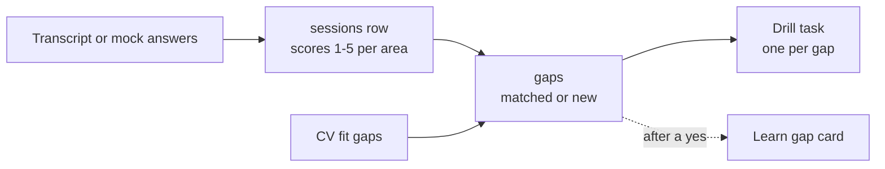
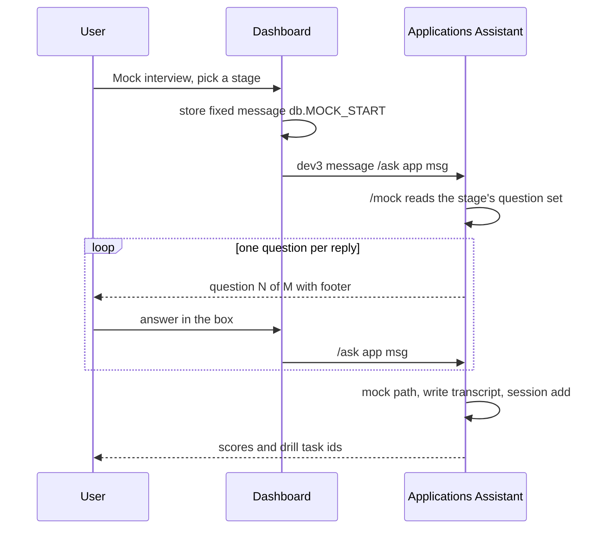

# Practice: sessions, gaps, debriefs and mocks

[Overview](../how-it-works.md) · [Reference index](README.md)

How practice is recorded: one row per practice session with scores per area, the weaknesses it
named as gaps, one drill task per gap, and the two skills that fill them (`/debrief` and `/mock`).

## Contents

- [Sessions](#sessions)
- [Gaps and drill tasks](#gaps-and-drill-tasks)
- [Commands](#commands)
- [Debriefs](#debriefs)
- [Mock interviews](#mock-interviews)



## Sessions

`sessions` holds one row per practice session (table: [database.md](database.md#practice)).

- **date**.
- **kind**: one of `db.SESSION_KINDS`: `mock`, or `real` for a real interview debriefed.
- **application** and **interview stage** (`db.INTERVIEW_STAGES`), both optional.
- **scores** per area as a JSON object (`{"system design": 3}`), whole numbers 1–5.
- **file**: the path of its transcript or notes. It must be under `private_dir`; a relative
  `--file` goes to `private_dir/sessions/`.

`db.record_session` checks every value first, so nothing is written when one is wrong. It inserts
the session, then `db.add_gap_drills` handles the named weaknesses.

A session on an application blocks Undo Interested, as gaps do
([applications.md](applications.md)).

## Gaps and drill tasks

Each weakness a session names:

- matches an open gap with the same text (ignoring case and spacing, as for CV fit gaps), or
- becomes a new gap with `gaps.session_id` pointing at the session, `session` set to its kind and the
  session's application.

A matched gap (for example one from a CV fit) gets the session only when it has none.

Every named gap without an open task gets one `drill` task, "Drill: <gap>" (`db.DRILL_TITLE`), linked
by `tasks.gap_id`, on the gap's application, due on `--due` or undated. The application's next action
follows ([applications.md](applications.md)).

CV fit gaps ([research.md](research.md)) get no drill until a session or `gap add` names them.

Closing a gap (`db.close_gap`) closes it and marks its open tasks done.

Gaps can also become Learn cards, after the user confirms: see
[learn.md](learn.md#import-and-gap-cards).

## Commands

| Command | What it does |
| --- | --- |
| `session add --kind K [--app ID] [--stage S] [--date D] [--score AREA=N ...] [--file F] [--gap TEXT ...] [--due D]` | Records a session with its gaps and drills (`db.record_session`). |
| `session list` | Sessions, newest first. |
| `gap add TEXT ... [--session ID] [--app ID] [--due D]` | Same gap and drill handling, without a new session. |
| `gap list [--all \| --closed]` | Each gap with its open drill count. |
| `gap close ID` | Closes the gap and marks its open tasks done (`db.close_gap`). |

All run as `python -m prep.cli …`.

## Debriefs

`/debrief` turns a pasted or dictated transcript of a real interview, or of a mock done elsewhere,
into one call:

```
prep.cli debrief --kind real|mock [--app ID] [--stage S] [--date D] [--questions T]
  [--went-well T] [--to-improve T] [--score AREA=N ...] [--gap TEXT ...] [--due D] [--transcript]
```

### The transcript file

`--transcript` reads stdin into a new file under `private_dir/sessions/`:

- named `DATE-COMPANY-STAGE-debrief.md`, with `-2`, `-3`, … when the name is taken;
- removed again when nothing is recorded.

### What `db.record_debrief` does

It checks every value first, then:

1. **Real interview** (an application is required): fills the questions, went well and to improve
   of the `interviews` row `/stage` stored for the same stage and date, or adds one through
   `add_interview`. It never calls `set_interview_date`, so no task dates move.
2. **Mock**: no `interviews` row. A mock is not an interview with the company, and its date would
   count as one. Its notes stay in the file.
3. `record_session` adds the session (kind `real` or `mock`; the stage defaults to the application's
   when that is an interview stage) with its gaps and drill tasks ([above](#gaps-and-drill-tasks)).
4. The application's open "Debrief — what to improve" task (`db.DEBRIEF_TASK`, added on Rejected and
   No response) is completed.

### Outcomes in the same text

An outcome is recorded by `/stage`, not by the debrief:

- a next round or an offer after the debrief (the application is still at the interview's stage);
- a rejection or withdrawal before it (with `--stage`), so the Debrief task it adds is completed.

/debrief also offers gap cards in the chat ([learn.md](learn.md#import-and-gap-cards)).

## Mock interviews

`/mock` runs in the Applications Assistant box ([assistants.md](assistants.md)). There is no
separate page and no table: the thread itself is the mock's state.



### Starting one

- An open application's panel has a Mock interview control in its shortcut row: a stage select
  (`db.INTERVIEW_STAGES`; the application's own when it is at an interview, else the first) and a
  button.
- It posts `/applications/mock` (`web.start_mock`). That stores a user message about the
  application with a fixed body built from the stage (`db.MOCK_START`, for example "Start a mock
  interview: coding interview (technical)"; no free text).
- The message is pinged as `/ask <app> <message>` like any message
  ([assistants.md](assistants.md#routing)).
- The control is hidden on a closed application, and the endpoint refuses one.

### Running it

- /ask hands the message to the /mock skill. It reads the stage's generic question set
  (`.claude/skills/mock/questions/<stage>.md`: score areas, rubric, questions) and the job's brief,
  description and company file.
- It replies with one question at a time. Each question ends with a fixed footer
  ("— Mock · <stage> · question N of M …"); the last reply ends with "— Mock · <stage> · finished.".
- While the most recent agent reply with a "— Mock ·" line is a question, a new message on that
  application is an answer.

### Finishing it

After the last answer, or "end mock":

1. `prep.cli mock path APP --stage S` prints the next free
   `private_dir/sessions/mock-<app>-<stage>-<date>.md`. It creates the folder and refuses without
   `private_dir`.
2. The skill writes only that mock's questions and answers there (pay replaced), with the scores and
   gaps.
3. It records the session with `session add --kind mock --app APP --stage S --file PATH
   --score AREA=N ... --gap ...` ([sessions](#sessions), [gaps](#gaps-and-drill-tasks)).
4. It replies in the thread with the scores and the drill task ids, and ends with a
   `— Gap cards · session #S` line ([learn.md](learn.md#import-and-gap-cards)).
