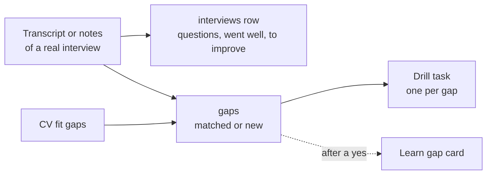

# Practice: debriefs, gaps and drill tasks

[Overview](../how-it-works.md) · [Reference index](README.md)

How interview practice is recorded: a debrief of a real interview, the weaknesses it names as gaps,
and one drill task per gap. Hirey runs no mock interviews and keeps no practice scores; practice
questions come from the Learn Assistant's quiz mode ([learn.md](learn.md)).

## Contents

- [Debriefs](#debriefs)
- [Gaps and drill tasks](#gaps-and-drill-tasks)
- [Commands](#commands)



## Debriefs

`/debrief` turns a pasted or dictated transcript of a real interview into one call:

```
prep.cli debrief --app ID [--stage S] [--date D] [--questions T] [--went-well T]
  [--to-improve T] [--gap TEXT ...] [--due D] [--transcript]
```

### The transcript file

`--transcript` reads stdin into a new file under `private_dir/sessions/`:

- named `DATE-COMPANY-STAGE-debrief.md`, with `-2`, `-3`, … when the name is taken;
- recorded on the interview (`interviews.file_path`);
- removed again when nothing is recorded.

### What `db.record_debrief` does

It checks every value first, then:

1. Fills the questions, went well and to improve of the `interviews` row `/stage` stored for the
   same stage and date, or adds one through `add_interview`. The stage defaults to the
   application's when that is an interview stage. It never calls `set_interview_date`, so no task
   dates move.
2. Records the named weaknesses as gaps with drill tasks, labelled `interview`
   ([below](#gaps-and-drill-tasks)).
3. Completes the application's open "Debrief — what to improve" task (`db.DEBRIEF_TASK`, added on
   Rejected and No response).

`db.debriefs` lists an application's debriefed interviews, newest first; `/reply` uses the latest
for a thank-you note.

### Outcomes in the same text

An outcome is recorded by `/stage`, not by the debrief:

- a next round or an offer after the debrief (the application is still at the interview's stage);
- a rejection or withdrawal before it (with `--stage`), so the Debrief task it adds is completed.

/debrief also offers gap cards in the chat, using the gap ids it printed
([learn.md](learn.md#import-and-gap-cards)).

## Gaps and drill tasks

Each weakness named (by a debrief or `gap add`, `db.add_gap_drills`):

- matches an open gap with the same text (ignoring case and spacing, as for CV fit gaps), or
- becomes a new gap on the given application, its `session` label saying where it came from.

Every named gap without an open task gets one `drill` task, "Drill: <gap>" (`db.DRILL_TITLE`), linked
by `tasks.gap_id`, on the gap's application, due on `--due` or undated. The application's next action
follows ([applications.md](applications.md)).

CV fit gaps ([research.md](research.md)) get no drill until a debrief or `gap add` names them.

Closing a gap (`db.close_gap`) closes it and marks its open tasks done. Gaps can also become Learn
cards, after the user confirms: see [learn.md](learn.md#import-and-gap-cards).

## Commands

| Command | What it does |
| --- | --- |
| `debrief --app ID ...` | Records a real interview's debrief ([above](#debriefs)). |
| `gap add TEXT ... [--app ID] [--due D]` | Gaps with drill tasks, matched against open gaps. |
| `gap list [--all \| --closed]` | Each gap with its open drill count. |
| `gap close ID` | Closes the gap and marks its open tasks done. |

All run as `python -m prep.cli …`.
