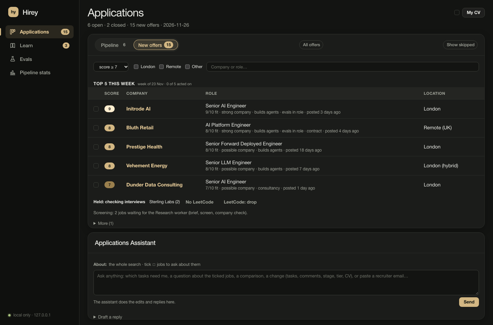
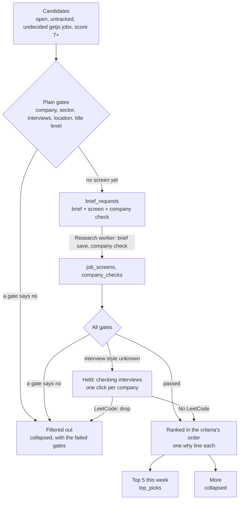

# Search: the gate and Top 5 this week

[Overview](../how-it-works.md) · [Reference index](README.md)

New offers shows a short, ranked list instead of every getjo match: jobs that passed the user's criteria,
with the research done, best fit first. Plain code answers what is plain; the Research worker answers what
needs judgement, through the existing brief queue. Code: `prep/criteria.py` (the file),
`prep/search.py` (gate, ranking, picks, company import).

## Contents

- [The flow](#the-flow)
- [The criteria file](#the-criteria-file)
- [Company checks](#company-checks)
- [Job screens](#job-screens)
- [The gate](#the-gate)
- [Ranking and the why line](#ranking-and-the-why-line)
- [The week's picks](#the-weeks-picks)
- [Agent work](#agent-work)
- [The result metric](#the-result-metric)
- [Commands](#commands)
- [Other sources](#other-sources)

## The flow

## The criteria file

- Private Markdown: `criteria_file`, default `private_dir/notes/criteria.md`
  ([configuration.md](configuration.md)). `criteria.example.md` in the repo shows the shape with
  made-up values. Without the file, New offers is the plain list with a note that Top 5 is off.
- Plain code reads (`criteria.parse`):
  - the numbered items under the `## Gates` heading, `N. **Name**: text`. Known names: Company,
    Sector, Interviews, Role family, Level, Team, Location, Pay. A gate left out of the file is off.
  - Level's `Out: a, b, c.` list: title words that fail the level gate.
  - Location's `<City> on-site or hybrid` and `remote within the <Region>`.
  - the numbered items under `## Ranking`, best first, matched to signals by their words (evals,
    verdict, fit score, permanent, product company, fresh posting "under N weeks", agents).
- The agent reads the whole file for its judgement calls.
- **Pay**: the pay gate's text is never kept by the code. Only the agent compares the ad with the
  floor in the file, and only `pass` / `fail` / `unknown` is stored. Unknown pay passes.

## Company checks

`company_checks` holds what the gate needs per company (`db.company_slug`), plus
`company_aliases` for other names a company is listed under in getjo.

| Field | Values | Meaning |
| --- | --- | --- |
| `verdict` | strong, possible, drop, unknown | drop fails the company gate |
| `sector_ok` | yes, no, unknown | the sector gate |
| `interviews` | yes, no, unknown | yes: no puzzle-style rounds; no: puzzle rounds or a timed screen |
| `kind` | product, consultancy, unknown | a ranking signal |
| `note` | one line, at most 300 characters | the interview style, shown on hover in Held; never pay |
| `source` | import, agent, user | who set it last |

- **Import** (`companies import FILE`): a researched list as JSON or a JS file holding a `companies`
  list (company, sector, verdict, leetcode_risk, interview_style), or a Markdown table
  `company | yes / no / mixed / unknown | evidence` from an interview check.
  - Interviews: high LeetCode risk is no, low is yes. Medium or unknown is no only when the style names a
    puzzle screen (LeetCode, Karat, HackerRank, CodeSignal, Codility, unless negated) and nothing
    practical (take-home, pairing, mixed); otherwise unknown, so the company is held and checked.
  - A verdict of strong or possible sets `sector_ok` yes. A sector naming consultancy or agency is a
    consultancy.
  - Names in brackets become aliases ("Group (Brand, incl. Label)"); places and "in ..." parts do not.
  - A company the agent or the user has checked keeps that check.
- **Agent** (`company check --job ID`): once per company, when there is no check or an imported one
  with the interview style or verdict unknown. `agent_checked_at` records it.
- **User**: Held's one click (`POST /offers/interviews`) or `company set NAME --interviews V`.

## Job screens

`job_screens` holds the Research worker's answers for one job, from the ad and the criteria file:
`role_family`, `level`, `team`, `location`, `builds_agents`, `evals` (yes / no / unknown), `pay`
(pass / fail / unknown) and `contract` (permanent / contract / unknown).

- Written with the brief: a `+++` TOML block before the brief's key facts line in `brief save`, or
  alone with `screen save`. Any other field or value is refused.
- A missing field is unknown.

## The gate

`search.gates` gives each criterion yes / no / unknown; two answers combine as no, then yes, else
unknown.

| Gate | Plain code | Agent |
| --- | --- | --- |
| company | verdict drop: no; strong or possible: yes; no check: yes for a getjo job (the watch list) | company check |
| sector, interviews | company check | company check |
| level | an Out word in the title: no; "Senior": yes | `level` |
| location | a named city: yes; remote with a named region: yes; bare remote or empty: unknown; else no | `location` |
| role family, team | – | `role_family`, `team` |
| pay | – | `pay`: fail is no |

A job's state (`search.evaluate`):

1. **failed**: any gate says no. Listed under Filtered out with the gates it failed.
2. **screening**: no screen yet. Counted on one line.
3. **held**: the interview style is unknown. Listed per company under Held, with No LeetCode and
   LeetCode: drop. A drop also filters every later job at that company.
4. **passed**: ranked.

Nothing here changes an application or decides for the user: a filtered job is only hidden, and All
offers lists every match.

## Ranking and the why line

- Each passed job gets one number per ranking signal; jobs sort by them in the criteria's order
  (`search.signals`). Yes beats unknown beats no; strong beats possible; product beats unknown beats
  consultancy; permanent beats unknown beats contract; fit is getjo's score; fresh is posted (else first
  seen) under the file's days.
- The why line names the reasons: "8/10 fit · strong company · builds agents · evals in role · posted
  3 days ago", plus "consultancy" or "contract" when they apply (`search.why_line`).

## The week's picks

`top_picks` keeps the jobs shown in a week's Top 5 (`week` is its Monday, `search.week_start`).

- Each view fills the week up to `top_per_week` (default 5) from the ranked passed jobs
  (`search.pick_week`).
- A pick the user acted on (Interested, applied, skipped) stays for the week with its outcome badge.
- A pick not acted on that stops passing or closes is dropped and the next job takes its place.
- Anything not acted on is a candidate again next week and is ranked afresh.
- Company, title, score and the why line are copied, so the metric survives getjo dropping the job.

## Agent work

With a criteria file, every candidate plain code does not fail gets one brief request
(`db.queue_screens`), routed and claimed like any brief ([research.md](research.md#job-briefs)):

- `brief next` prints the brief format, the screen format, a company check when the company needs one,
  and company research (`research save --job ID`, a profile with no tier) when no fresh profile exists.
- A job with a brief but no screen is queued once more for the screen only (`screen_asked`), so an old
  brief gets its screen without a loop.
- A job plain code fails gets no agent work, not even the score-8 automatic brief.

## The result metric

Pipeline stats' "Top 5: how many were applied to" ([metrics.md](metrics.md#definitions)): every job
ever picked counts once; the share applied to, and how many are Interested, were skipped (by reason) or
were not acted on (`search.pick_stats`).

## Commands

| Command | What it does |
| --- | --- |
| `python -m prep.cli top` | the week's Top 5 with why lines, then held, screening, more and filtered counts (fills the picks) |
| `python -m prep.cli companies import FILE [--dry-run]` / `companies list` | import a researched company list; list every check |
| `python -m prep.cli company check --job ID` | the Research worker's company check (TOML on stdin) |
| `python -m prep.cli company set NAME --interviews yes\|no\|unknown` | the user's call on a company |
| `python -m prep.cli screen save --job ID` / `screen show --job ID` | a job's screen (TOML on stdin) |

## Other sources

`search.evaluate` takes a plain job dict (id, company, title, location, score, posted_at, first_seen and
`origin`). A source other than getjo builds the same dict with its own `origin`; without a company
check its company gate is unknown until the company is checked.
