# Usage

[Overview](how-it-works.md) · [Reference index](reference/README.md)

How to set Hirey up, try it, run its commands and keep the standing agents and the dashboard
running. What each page and agent does in detail is on the [reference pages](reference/README.md);
the system diagram and key flows are in [how-it-works.md](how-it-works.md).

## Contents

- [Setup](#setup)
- [Try it with example data](#try-it-with-example-data)
- [Commands](#commands)
- [The dashboard](#the-dashboard)
- [Standing agents](#standing-agents)
- [Keep it running with launchd (macOS)](#keep-it-running-with-launchd-macos)
- [Token usage](#token-usage)
- [Privacy model](#privacy-model)

## Setup

```bash
git clone <this repo> inter_prep && cd inter_prep
mkdir -p ~/.config/inter_prep
cp config/settings.example.toml ~/.config/inter_prep/settings.toml
# edit it: absolute paths for getjo_db, prep_db, private_dir
python -m unittest
```

The settings file is looked up in `$INTERPREP_SETTINGS`, then `config/settings.toml` in the checkout
(gitignored), then `~/.config/inter_prep/settings.toml`. The per-user file is the normal place: every
checkout and git worktree, the launchd job and the Claude app find it without environment variables.
Use absolute paths, with `prep_db` outside any worktree. Every key, the `[workers]` and `[prices]`
tables and the `PREP_*` environment overrides are in [reference/configuration.md](reference/configuration.md).

The tailored CV PDF (and the launchd job below) use a virtual environment in the main checkout.
WeasyPrint needs Pango from Homebrew on macOS:

```bash
brew install pango
/opt/homebrew/opt/python@3.14/bin/python3.14 -m venv .venv    # a versioned Python, not the python3 alias
.venv/bin/pip install -r requirements.txt
.venv/bin/python -m unittest                                    # now also runs the PDF render tests
```

A venv belongs to one Python minor version: after moving to a new one (3.14 to 3.15), delete
`.venv` and create it again with the new interpreter. If WeasyPrint reports that it cannot load a
library (`gobject-2.0`, `pango-1.0`), run it with `DYLD_FALLBACK_LIBRARY_PATH=/opt/homebrew/lib`.
The skills run the system `python3`, and a dev3 worktree has no venv, so point the settings at
this one for the PDF step:

```toml
pdf_python = "/absolute/path/to/inter_prep/.venv/bin/python"
```

## Try it with example data

```bash
python -m prep.seed_example
PREP_ASSISTANT_TASK= PREP_PREP_ASSISTANT_TASK= PREP_WORKER_RESEARCH= PREP_WORKER_COMMS= PREP_DB=data/example.db PREP_GETJO_DB=$PWD/data/example-getjo.db python -m prep.cli today
PREP_ASSISTANT_TASK= PREP_PREP_ASSISTANT_TASK= PREP_WORKER_RESEARCH= PREP_WORKER_COMMS= PREP_DB=data/example.db PREP_GETJO_DB=$PWD/data/example-getjo.db python -m prep.web --port 8766
# then open http://localhost:8766
```

The empty `PREP_ASSISTANT_TASK=`, `PREP_PREP_ASSISTANT_TASK=`, `PREP_WORKER_RESEARCH=` and
`PREP_WORKER_COMMS=` keep the example run away from the standing agents set in the settings file:
its messages and queued research would otherwise be sent to them.

The seed also writes made-up Claude Code transcripts to `data/example-claude-projects/` (token
counts only). To see them on the Usage & cost page (with a made-up Research worker, seq 71), name the
example assistants and point at a dev3 that does not exist, so nothing can be sent anywhere:

```bash
PREP_ASSISTANT_TASK=7 PREP_PREP_ASSISTANT_TASK=9 PREP_WORKER_RESEARCH=71 PREP_WORKER_COMMS= \
PREP_ASSISTANT_PROJECT=e0e0e0e0-1111-4222-8333-944445555666 \
PREP_DEV3_BIN=/nonexistent/dev3 PREP_CLAUDE_PROJECTS_DIR=$PWD/data/example-claude-projects \
PREP_DB=data/example.db PREP_GETJO_DB=$PWD/data/example-getjo.db python -m prep.web --port 8766
# then open http://localhost:8766/usage
```

The seed also copies a made-up eval catalogue and runs to `data/example-getjo-repo/`. Add
`PREP_GETJO_REPO=$PWD/data/example-getjo-repo` to the dashboard command and open `/evals`.

The seed shifts the example dates so the most recent ones fall around today. The example databases
are built from made-up fixtures in `tests/fixtures/example.json` (fictional companies only) and are
gitignored.

## Commands

| Skill      | CLI                                                                 | What it does |
|------------|---------------------------------------------------------------------|--------------|
| `/today`   | `python -m prep.cli today [--threshold 7] [--limit 15]`              | Applications moved to No response, pending agent work, job briefs, thread and draft messages, Learn Assistant messages, Learn cards done and to do, tasks due or overdue, new getjo matches |
|            | `python -m prep.cli queue`                                           | Read-only: counts and ids of queued agent work, briefs and waiting messages, and which worker owns them (used by the SessionStart hook) |
| `/applied` | `python -m prep.cli applied --job-id ID \| --url URL \| --company C --role R [--status to_apply] [--date D]` | Record an application (applied today, or Interested with `--status to_apply`), linked to getjo when it matches; adds its first tasks |
|            | `python -m prep.cli apps [--status S]`                               | List applications |
| `/stage`   | `python -m prep.cli update ID [--status S [--comment T] [--interview-date D]] [--next-action T [--next-date D]]` | Move an application to a stage (closes the old stage's tasks, adds the new ones); `--next-action` adds a task. Already at that stage: the comment and an interview date are still saved. `/stage` takes a pasted recruiter email, call notes or a one-line message and runs this (plus `comment` / `task add`) itself |
|            | `python -m prep.cli comment ID "text"`                               | Comment on an application |
| `/task`    | `python -m prep.cli task add "Title" [--kind K] [--due D]` / `task list` / `task done ID` | Tasks |
| `/research` | `python -m prep.cli research next [ID]` / `research queue ID [--kind K] [--redo]` / `research save ID` / `fit save ID` | Queued company research and CV fit checks: the agent writes `companies/<slug>.md` and `fit/<id>-<slug>.md` in `private_dir` and saves a summary |
|            | `python -m prep.cli research block APP [--kind K] --reason R` / `brief block (--job ID \| APP) --reason R` | Mark work the worker cannot do as blocked, with a reason (Workers sidebar, Run history) |
|            | `python -m prep.cli brief next` / `brief save (--job ID \| APP)` / `brief show (--job ID \| APP)` / `brief queue (--job ID \| APP) [--redo]` | Job briefs: claim the oldest waiting one, store it (text on stdin), print it, or ask for one |
| `/research`, `/ask` | `python -m prep.cli tailor path APP [--role-short X] [--copy]` / `tailor save APP [--to MSG]` | Tailored CV: print the next version's file, then save it as a new version (note on stdin); saving also makes the PDF, runs the rule checks and queues the AI check |
|            | `python -m prep.cli tailor pdf APP [--version N]`                    | The PDF of a tailored CV version (latest by default), beside its file |
|            | `python -m prep.cli tailor check APP [--version N]` / `tailor eval APP [--version N] [--file F]` | Check a version again without WeasyPrint; store the AI check (grounding, fit, skim, editorial) from its `.eval.md` file |
| `/ask`     | `python -m prep.cli thread show [APP \| --job ID \| --message MSG \| --cv] [--claim]` / `thread reply [APP] --to MSG` / `thread pending` | The Applications Assistant box: a thread with its context (no id: the whole search; `--job`: an offer not yet tracked; `--message`: a comparison), the reply (text on stdin or `--file`), the messages waiting |
|            | `python -m prep.cli thread close MSG`                               | Close a waiting message that needs no reply |
|            | `python -m prep.cli review [--all]`                                  | Read-only: the top 3 open tasks in review order (`--all`: every open task) |
|            | `python -m prep.cli task edit ID [--title T] [--due D \| --no-due]` / `task delete ID` | Change or delete a task |
|            | `python -m prep.cli comments list APP` / `comments amend REF "text"` / `comments remove REF` | An application's comments with their refs (`c12`, `h34`); a removed stage comment keeps its move |
| `/ask`, `/research` | `python -m prep.cli notes APP [--show \| --append [TEXT]]` | The panel's Notes: print them, or add a dated "Agent · 17 Nov" block at the end (TEXT, or stdin when left out); never rewrites the user's text, refuses pay |
| Learn Assistant | `python -m prep.cli learn-notes CARD_ID\|all [--show \| --append [TEXT]]` | The Learn page's Notes: a card's note or the "all prep" notebook; print it, or add a dated "Agent" block at the end; never rewrites, refuses pay |
| Learn Assistant | `python -m prep.cli learn-notes answer CARD_ID [--show]` | The user's own answer on a card (Your answer); read only |
| `/learn-ask` | `python -m prep.cli learn-thread show MSG [--claim]` / `learn-thread reply --to MSG` / `learn-thread pending` | The Learn page's Learn Assistant: a message with its card (front, back, follow-ups, Learn sources), the track's chapters, the private context files and the conversation; the reply (text on stdin or `--file`); the messages waiting |
| `/explainer` | `python -m prep.cli explainers path CARD` / `explainers save CARD --snippet FILE:FUNCTION ...` / `explainers check [--card ID]` | A card's explainer page (asked from the Learn page, answered by the Learn Assistant): where it goes, then the sidecar with getjo's commit and each quoted function's hash (computed by Hirey); the check against getjo's code now |
|            | `python -m prep.cli skip APP --reason R [--comment T]`               | Skip an Interested application (listed under New offers → Show skipped) |
|            | `python -m prep.cli cv sent APP FILE_NAME`                           | Record which tailored version was sent |
|            | `python -m prep.cli cv show \| skills \| history \| draft` / `cv save --note T [--to MSG]` / `cv restore V` / `cv diff V` | The master CV: print it, its skills by theme, its saved versions; save the edited draft (the current text is saved as a version first), restore or compare a version |
| `/mock`    | `python -m prep.cli mock path APP --stage S [--date D]`              | The transcript file for a new mock, under `private_dir/sessions/` |
|            | `python -m prep.cli session add --kind mock\|real [--app ID] [--stage S] [--score AREA=N ...] [--file F] [--gap TEXT ...]` / `session list` | Record a practice session with 1–5 scores per area; each gap named gets a drill task |
|            | `python -m prep.cli gap add TEXT ... [--app ID]` / `gap list [--all \| --closed]` / `gap close ID` | Gaps: each gets a drill task; closing a gap completes its drill tasks |
| `/debrief` | `python -m prep.cli debrief --kind real\|mock [--app ID] [--stage S] [--questions T] [--went-well T] [--to-improve T] [--score AREA=N ...] [--gap TEXT ...] --transcript` | After a real interview or a mock done elsewhere: saves the transcript (stdin) under `private_dir/sessions/`, the interview's questions, went well and to improve (real only), a session with scores, and a gap with a drill task per weakness; completes the Debrief task |
|            | `python -m prep.cli tracks list` / `tracks add TITLE [--subtitle T] [--cover C] [--slug S]` | Learn tracks: chapters, done / total and percent done; add a track |
|            | `python -m prep.cli cards add [--file F]` / `cards list [--track T] [--todo \| --done]` / `cards show ID` / `cards done ID` / `cards undo ID` / `cards delete ID` | Learn cards: add from JSON (one card or a list, all or none), list, show (with `[x]` / `[ ]` before each Learn source), mark done or back to do, remove |
|            | `python -m prep.cli cards import FILE [--dry-run]`                   | Add or update tracks and cards from Markdown ([format](learn-format.md)); the same track and front is updated, its done status kept |
|            | `python -m prep.cli cards gaps [--gap ID ...] [--app ID] [--session ID] [--limit N]` | Read-only: card drafts (JSON) for open gaps without a card; /mock and /debrief fill and save them with `cards add` after a yes |
| `/reply`   | `python -m prep.cli reply show MSG [--claim]` / `reply save --to MSG [--subject S] [--note N]` | Draft a reply: the request with its context; save the draft (on stdin; email needs a subject) |
|            | `python -m prep.cli usage scan`                                     | Read new Claude Code transcript lines (counts only) for Usage & cost |
|            | `python -m prep.cli feedback export [--out PATH]`                    | Write interested/applied/skipped labels as JSONL to `private_dir/feedback/job_decisions.jsonl` for getjo |

Dates accept `YYYY-MM-DD`, `today`, `tomorrow` or `+N` (days from today).


## The dashboard

`python -m prep.web [--port 8765]` serves the dashboard on `127.0.0.1` only (standard library
`http.server`, plain HTML, CSS and a small script; no build step, no external requests). Each request
opens the database afresh, so changes made through the skills show on the next poll or page load.

| Page | URL | What it is for | Detail |
| --- | --- | --- | --- |
| Applications | `/` (`?view=pipeline` or `offers`) | Pipeline by stage and New offers from getjo; the selected job's panel; the Applications Assistant box; My CV | [dashboard.md](reference/dashboard.md), [applications.md](reference/applications.md) |
| Learn | `/learn` | Tracks and cards, Your answer, notes, explainers, the Learn Assistant | [learn.md](reference/learn.md) |
| Evals | `/evals` | getjo's evaluations, each run and its history (needs `getjo_repo`) | [evals.md](reference/evals.md) |
| Usage & cost | `/usage` | What Claude Code costs, where the money goes, how long work takes | [metrics.md](reference/metrics.md) |
| Pipeline stats | `/stats` | Applications per week, response rate, stage funnel, job boards | [metrics.md](reference/metrics.md) |
| Run history | `/runs` | Every worker run, filtered by worker and result | [assistants.md](reference/assistants.md#workers-sidebar-and-run-history) |

Old URLs (`/metrics`, `/metrics/runs`, `/dashboard`, `/progress`, `/offers`) redirect
([routes.md](reference/routes.md#redirects-from-old-urls)). Optional settings: `dashboard_port`
(8765), `weekly_target` (10 a week, the target line on Pipeline stats) and `no_response_days` (14: an
application in Applied with no change for that long moves to No response).

Everyday flow:

- **New offers**: open an offer to read its job brief, then **Interested** (queues company research
  and a CV fit) or **Skip** with a reason.
- **Pipeline**: open an application for its tasks, notes and results. **Tailor CV** asks for a copy of
  the CV for this job ([cvs.md](reference/cvs.md)); **Mock interview** starts one in the box.
- **Applications Assistant box**: tick rows to say what a message is about (none: the whole search;
  two to four: a comparison), then ask a question, ask for a change or paste a recruiter email.
- **Learn**: open a card, say the answer in Your answer, **Check my answer**, read the explainer;
  highlight any text and **✦ Ask about this** sends it to the Learn Assistant.

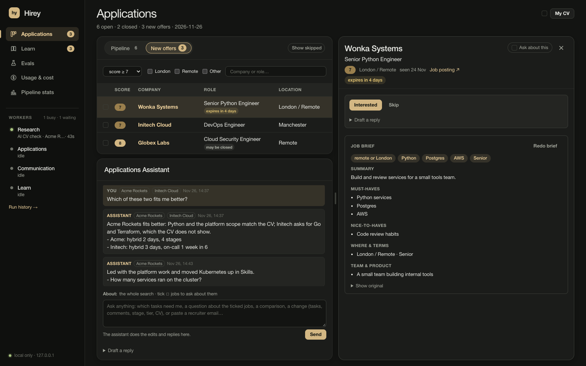
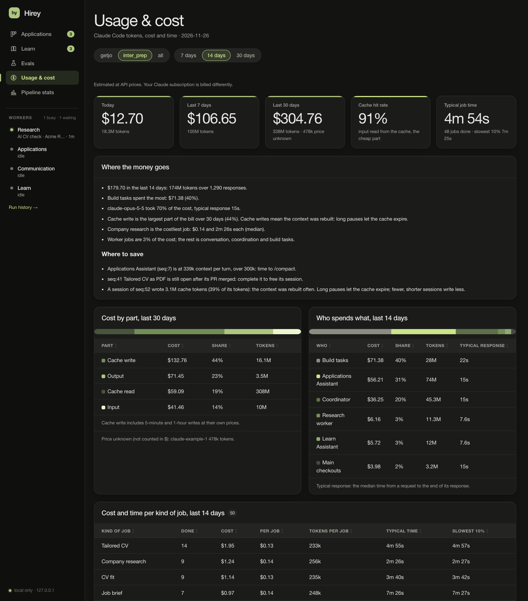
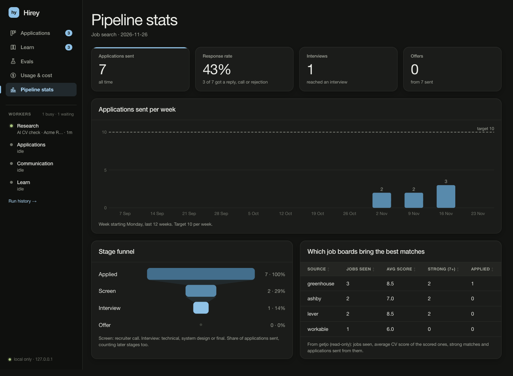
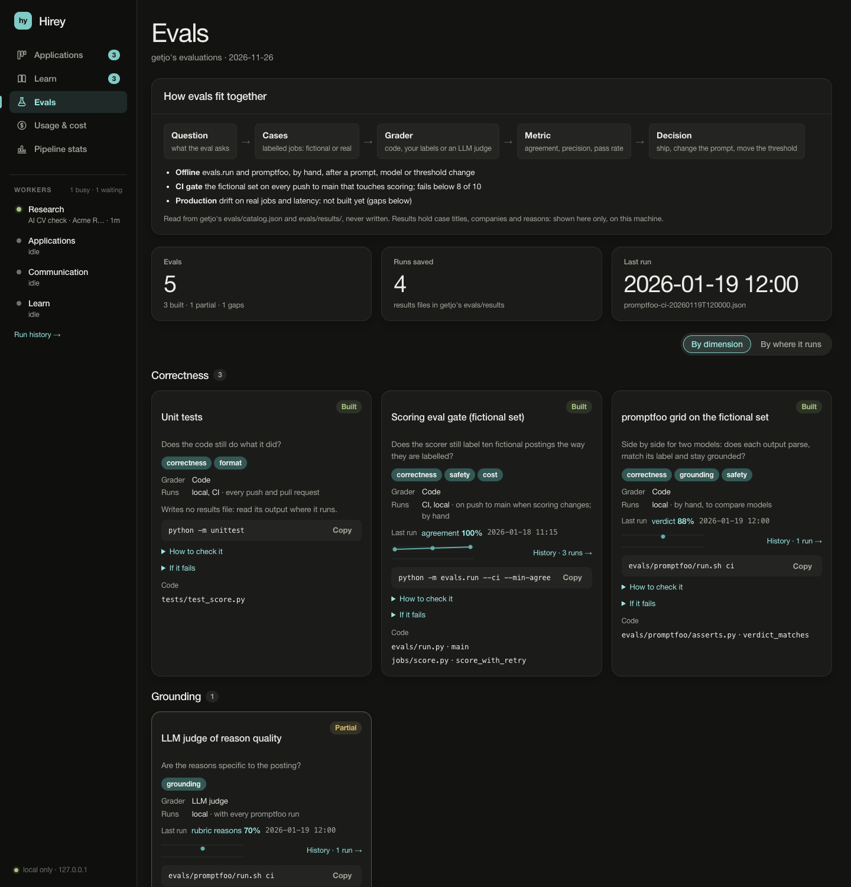
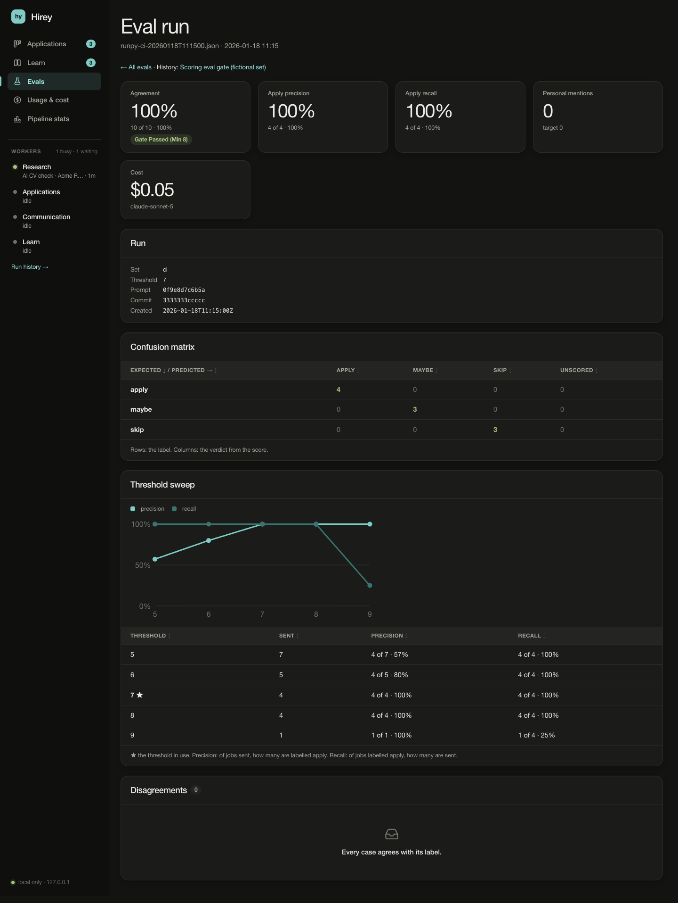
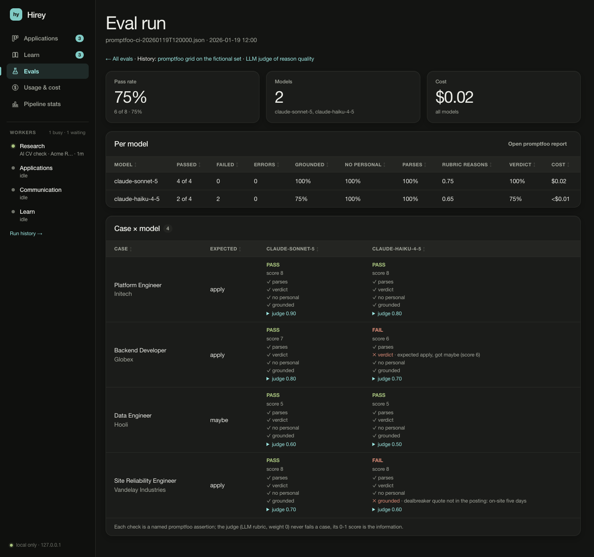
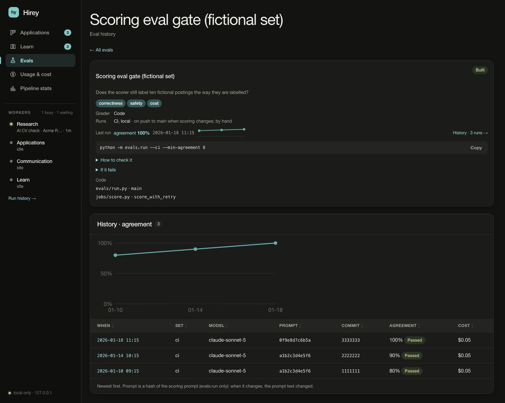

## Standing agents

The dashboard never runs a model. It stores each request and pings a standing dev3 task with ids
only; without one, the request waits for any Claude Code session (the SessionStart hook and `/today`
report it). Routing, leases and the 30-minute "no reply" rule are in
[reference/assistants.md](reference/assistants.md).

| Agent | Setting | Gets | Runs |
| --- | --- | --- | --- |
| Applications Assistant | `assistant_task` | `/ask …` messages; also research, briefs and drafts while no worker is set | /ask, /stage, /mock, /research, /reply |
| Learn Assistant | `prep_assistant_task` | `/learn-ask …` messages from the Learn page | /learn-ask, /explainer |
| Research worker | `[workers] research` | `/research <id>`, `/research briefs` | /research |
| Comms worker | `[workers] comms` | `/reply …` draft requests | /reply |

To set one up:

1. On the project's dev3 board, create a task (for example "Applications Assistant") with a
   description that names the messages it gets and the skill each runs, for example: "Standing
   Applications Assistant for Hirey. When messaged `/ask <app> <msg>` run /ask; `/research <id>` or
   `/research briefs` run /research; `/reply <app> <msg>` run /reply. Between messages, wait. Never
   commit, push, apply to jobs or contact anyone." Start it with Claude Code and leave it running.
2. Note its seq number (on the card), and the project id if the dashboard runs outside that project
   (`dev3 current` inside the task prints both).
3. Add it to `~/.config/inter_prep/settings.toml`. Keep `[workers]` at the end of the file: TOML puts
   every key after a table header inside that table.

   ```toml
   assistant_task = 23                  # Applications Assistant
   prep_assistant_task = 24             # Learn Assistant
   # assistant_project = "<project id>" # only when needed
   # dev3_bin = "/absolute/path/to/dev3" # if launchd cannot find dev3 on PATH

   [workers]
   research = 25                        # or [25, 27] for two Research workers
   comms = 26
   ```

4. Restart the dashboard (`launchctl kickstart -k gui/$(id -u)/uk.inter-prep.dashboard`, or stop and
   start `python -m prep.web`). A request now arrives in that task's terminal, and the
   Applications Assistant box shows who has it ("Tailored CV → Research worker") until it is done.

With several Research workers, each new item goes to a worker with nothing claimed or waiting, else
in turn, and two workers never take the same item. A worker that cannot do an item marks it blocked
with a reason (`research block`, `brief block`); queue it again from the panel once fixed.

### Workers sidebar and Run history

With any agent set, every page's sidebar shows a **Workers** block: "1 busy · 1 waiting", then one
row per agent with a dot (green working, grey idle, amber stuck: no reply in 30 min, a claim past its
lease, or blocked) and its current item. Click a row for **Now** (with **Open job** and **Stop**),
**Queued** and **Last runs**. **Run history →** opens `/runs`. Workers record which task took an item
from dev3's `DEV3_TASK_SEQ`, so nothing else needs setting.

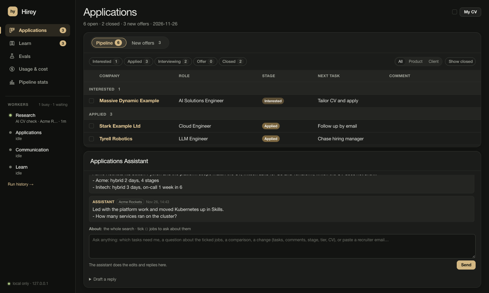
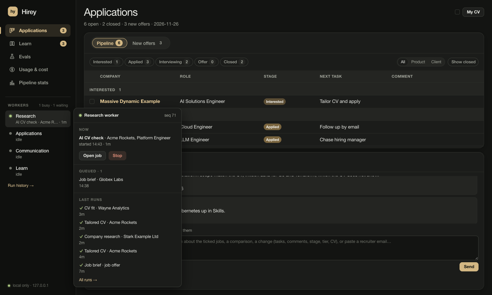
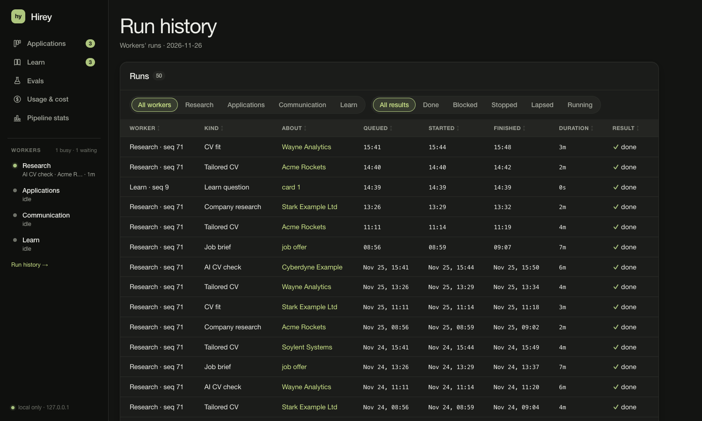

### Draft a reply (recruiter messages)

Recruiter conversations stay in LinkedIn and the mail app; Hirey drafts the replies.

- **From a message already in the box.** A recruiter's message pasted into the Applications
  Assistant box (for example to ask for feedback on it) gets an action row: **Draft reply ·
  LinkedIn | Email**. One click asks for the reply; nothing is pasted again.
- **From the form.** Open the application (or the job offer, or use the box's own form for the whole
  search), unfold **Draft a reply**, pick Reply, Follow-up or Thank-you note and LinkedIn or Email,
  and add a line on what to say ("free Tue/Wed after 2, ask about hybrid"). Paste the recruiter's
  message, or leave the box empty: a reply then uses the latest message sent about this application,
  named under the box ("Left empty, a reply uses your message of Nov 26, 14:02: '…'"). With no such
  message, a reply needs the paste. A follow-up or a thank-you note needs none.

The draft arrives in the Applications Assistant box with **Copy** (email: **Copy subject** and **Copy
body**); paste it and send it yourself. Nothing is sent from Hirey. An interview the message books is
recorded on the application; a rejection or anything else is only proposed in the note above the
draft. Without a Comms worker the Applications Assistant writes the draft; with neither set, run
/reply in any Claude Code session.

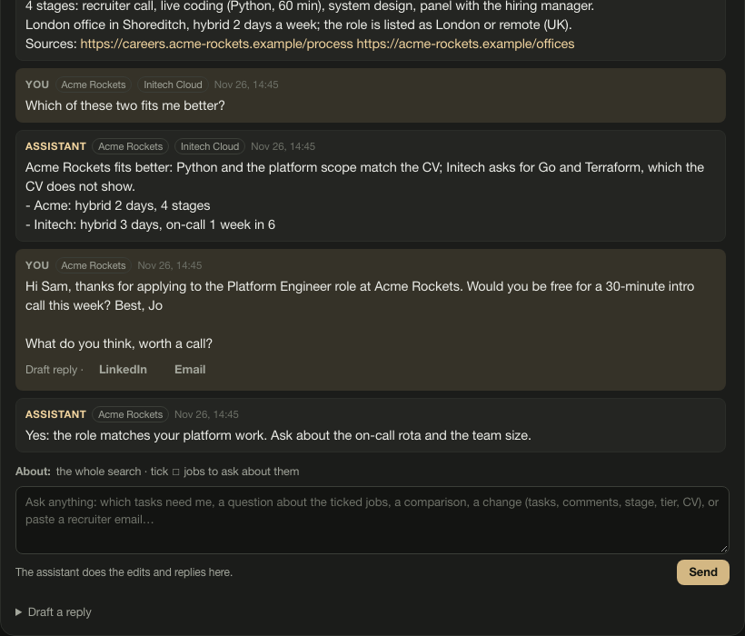
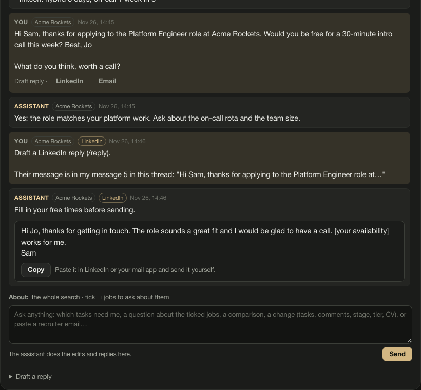
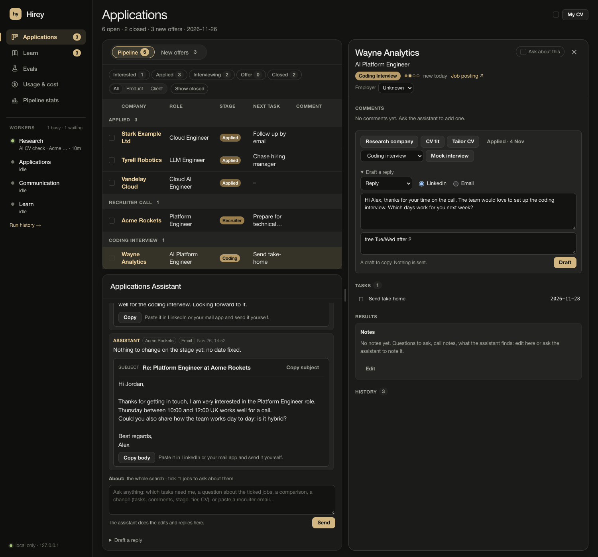
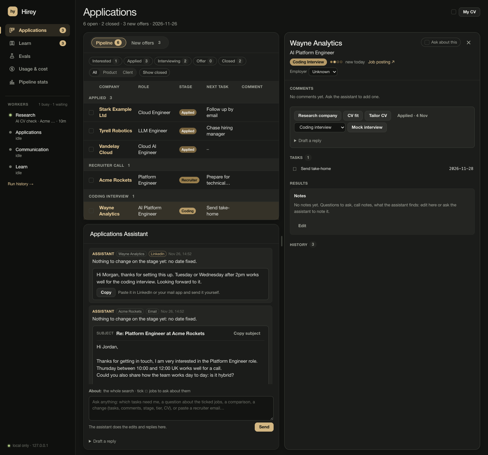
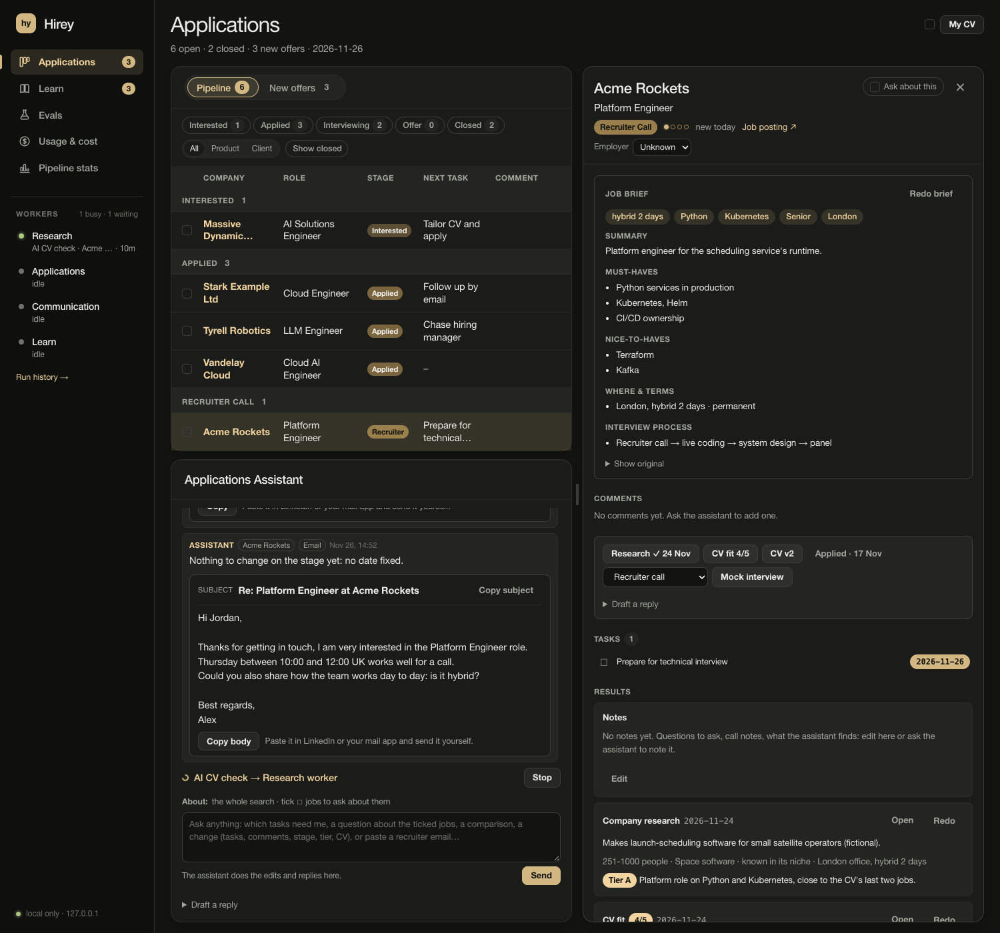

### Comms worker (optional)

A standing dev3 task that writes the drafts, so a long /ask conversation never delays them.

1. Create a dev3 task, for example "Comms worker", with this description: "Standing comms worker for
   Hirey. When messaged `/reply <app | job | general> <msg>`, run /reply. Between messages, wait.
   Never send email or messages, never commit, push, apply to jobs or contact anyone." Start it with
   Claude Code and leave it running.
2. Add its seq under `[workers]` in `~/.config/inter_prep/settings.toml` (or `PREP_WORKER_COMMS`):

   ```toml
   [workers]
   comms = 26                           # the Comms worker task's seq
   ```

3. Restart the dashboard. A draft request now shows "→ Comms worker" and arrives in that
   task's terminal as `/reply <id> <msg>`.

CLI: `python -m prep.cli reply show MSG [--claim]`, `reply save --to MSG [--subject S] [--note N]`
(the draft on stdin).

## Keep it running with launchd (macOS)

The template `launchd/uk.inter-prep.dashboard.plist.example` starts the dashboard at login
and restarts it if it stops. launchd does not read shell profiles, so the dashboard takes its
settings from `~/.config/inter_prep/settings.toml` (set `prep_db` and `getjo_db` there).
Use the main checkout, not a dev3 worktree, which is deleted when its task completes.

Install, from the main checkout, once its `.venv` exists (Setup):

```bash
sed -e "s|/ABSOLUTE/PATH/TO/inter_prep|$PWD|g" \
    launchd/uk.inter-prep.dashboard.plist.example > ~/Library/LaunchAgents/uk.inter-prep.dashboard.plist
plutil -lint ~/Library/LaunchAgents/uk.inter-prep.dashboard.plist
launchctl bootstrap gui/$(id -u) ~/Library/LaunchAgents/uk.inter-prep.dashboard.plist
open http://localhost:8765    # Applications; Pipeline stats at /stats, Usage & cost at /usage
```

(`cp` the template and edit the placeholder by hand if preferred.) The job runs the venv's
Python, `.venv/bin/python` in the main checkout, never the `python3` on the PATH or a pyenv or
asdf shim: launchd has no shell state, and the venv keeps its interpreter when Homebrew's
`python3` moves to a newer version. After a Python minor upgrade, recreate `.venv` (Setup)
and restart the job (`launchctl kickstart -k`, below).

Everyday commands (run from anywhere):

```bash
# Is it running? (look for "state = running" and the pid)
launchctl print gui/$(id -u)/uk.inter-prep.dashboard | grep -E "state =|pid =|last exit"

# Update to the latest main and restart, so the new code is served
git -C /path/to/inter_prep pull --ff-only
launchctl kickstart -k gui/$(id -u)/uk.inter-prep.dashboard

# Follow the log (request lines and errors; never request bodies)
tail -f /path/to/inter_prep/data/dashboard.log

# Stop until the next login, then start again
launchctl bootout gui/$(id -u)/uk.inter-prep.dashboard
launchctl bootstrap gui/$(id -u) ~/Library/LaunchAgents/uk.inter-prep.dashboard.plist

# Something else holds port 8765?
lsof -nP -iTCP:8765 -sTCP:LISTEN
```

`/path/to/inter_prep` is the main checkout. `kickstart -k` restarts a running job; after
`bootout` the job is unloaded, so use `bootstrap` to start it again (it also starts at the
next login on its own).

Uninstall:

```bash
launchctl bootout gui/$(id -u)/uk.inter-prep.dashboard
rm ~/Library/LaunchAgents/uk.inter-prep.dashboard.plist
```

## Token usage

The Usage & cost page reads Claude Code's transcripts under `claude_projects_dir` (default
`~/.claude/projects`), read only: times, models and token counts, never message text. Each page load
reads only what was appended since the last one; `python -m prep.cli usage scan` does the same from
the command line. A session's working directory names its dev3 task, whose seq and title come from
`dev3`. Dollars are estimates at the built-in list prices in `prep/prices.py`, overridable with
`[prices."<model>"]` in the settings. Definitions, pricing rules and the settings
(`coordinator_task`, `context_warn_tokens`) are in [reference/metrics.md](reference/metrics.md).

## Privacy model

The repository is public (on GitHub as Hirey); personal data stays local.

- Personal files are gitignored and live in `private_dir`: `cv.md`, `cv-facts.md`, `cv-history/`,
  `cv-tailored/`, `companies/`, `fit/`, `notes/`, `sessions/`, `learn/`, `stories.md`, `gaps.md`,
  `design-cases.md`, `mock-interview-kit.md`, `*.docx`, `*.xlsx`, `*.pdf`, databases,
  `config/settings.toml`, `.env` and `.claude/skills/board/`. `prep/privacy.py` holds the list;
  committed templates use the `.example` suffix.
- Pay is stored only in the local database: in `applications.pay`, and in agent-thread messages
  as pasted. It never goes into committed files, fixtures, logs, commit messages, the dev3 ping
  or files the agents write, unless asked.
- getjo's database is opened read-only (SQLite `mode=ro`); a write attempt fails.
- The dashboard listens on `127.0.0.1` only, makes no external requests and never shows the pay field.
- Nothing in this project applies to jobs, sends email or posts anywhere.
- `tests/test_privacy.py` fails if `git ls-files` lists any personal file. The same check runs
  as a pre-commit hook on staged files.

### Pre-commit hook

From the repo root, either point git at the `scripts/` folder:

```bash
git config core.hooksPath scripts
```

or copy the hook (works in worktrees too, where `.git` is a file):

```bash
cp scripts/pre-commit "$(git rev-parse --git-path hooks)/pre-commit"
chmod +x "$(git rev-parse --git-path hooks)/pre-commit"
```

Run the check by hand with `python -m prep.privacy` (tracked files) or
`python -m prep.privacy --staged`.

## Docs

- [README](../README.md): overview
- [how-it-works.md](how-it-works.md): system diagram, key flows, data model
- [reference/](reference/README.md): one page per area
- [ROADMAP.md](ROADMAP.md): phases and acceptance criteria
- [CLAUDE.md](../CLAUDE.md): conventions for the coding agents working in this repo
